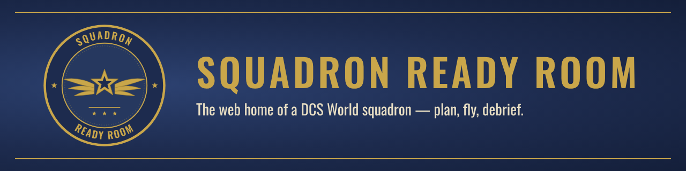
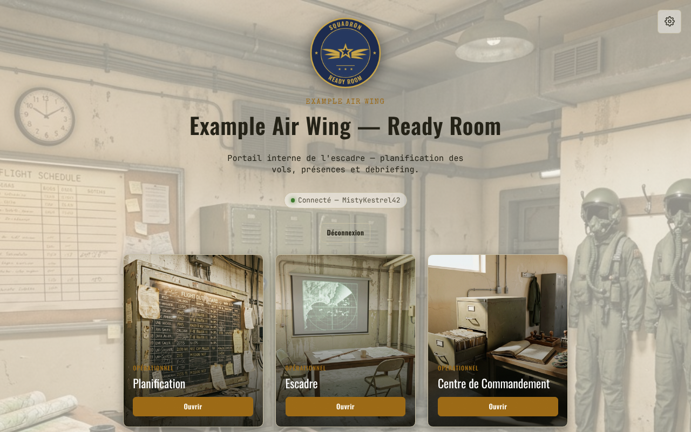
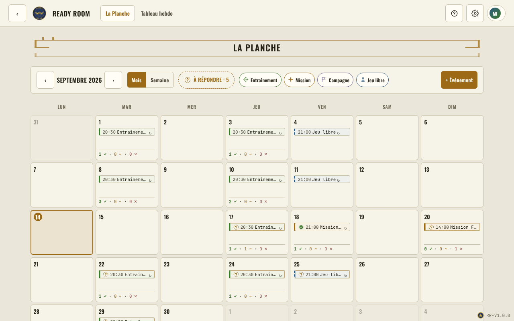
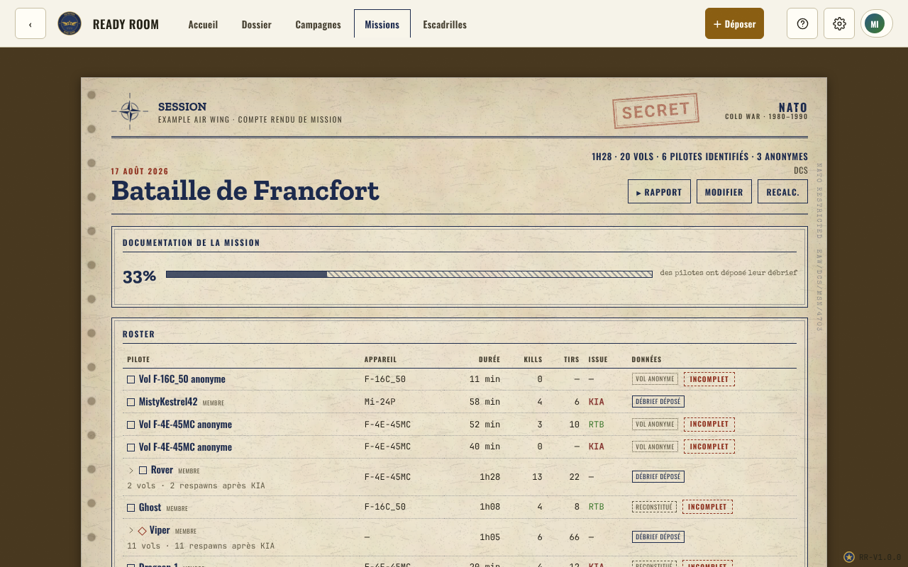
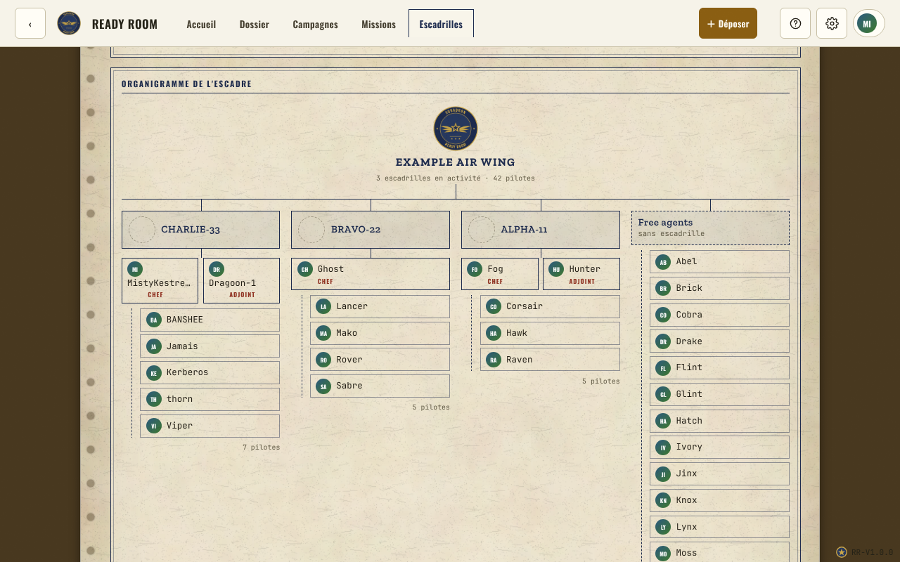
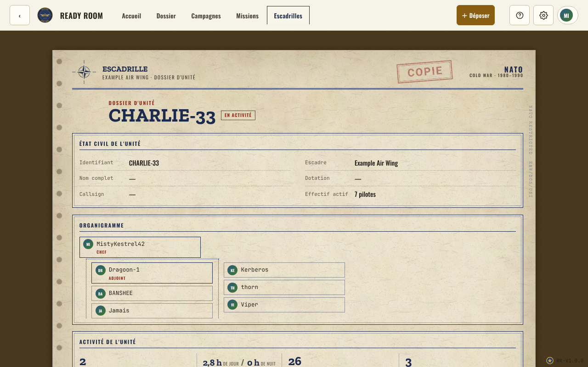
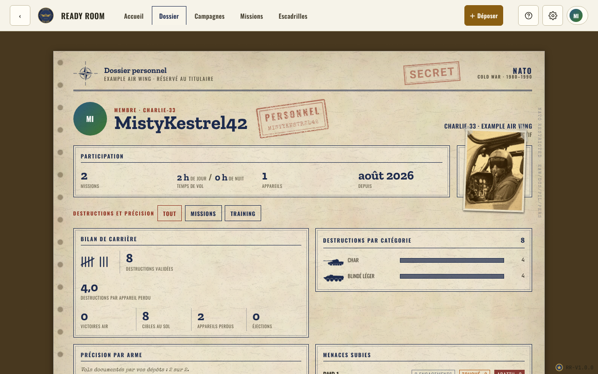
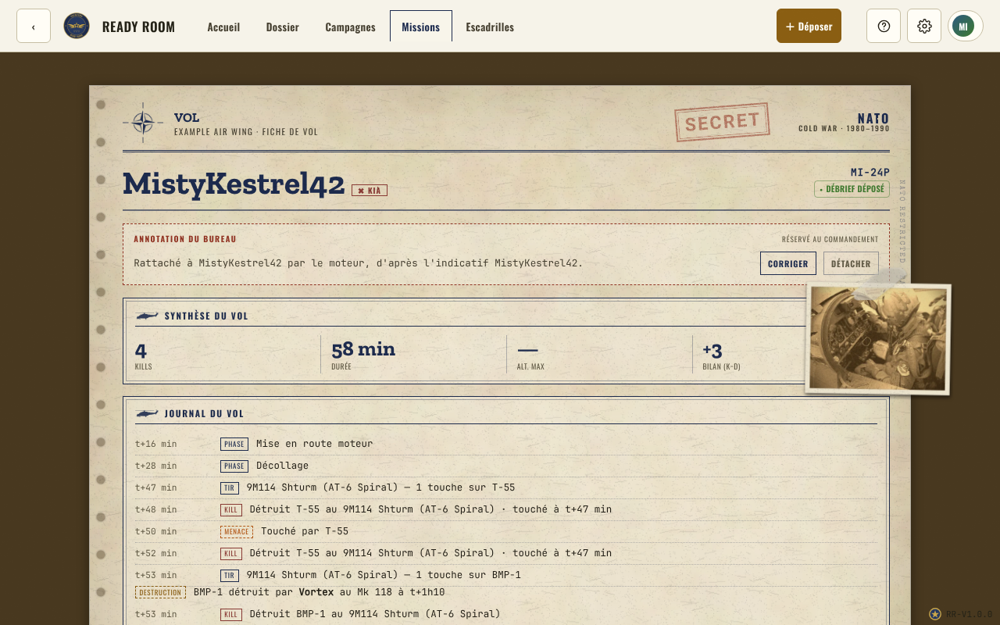
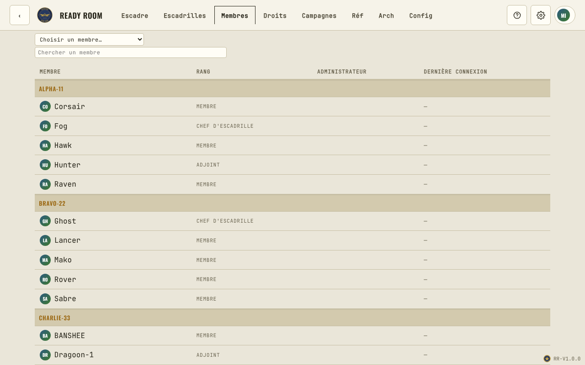
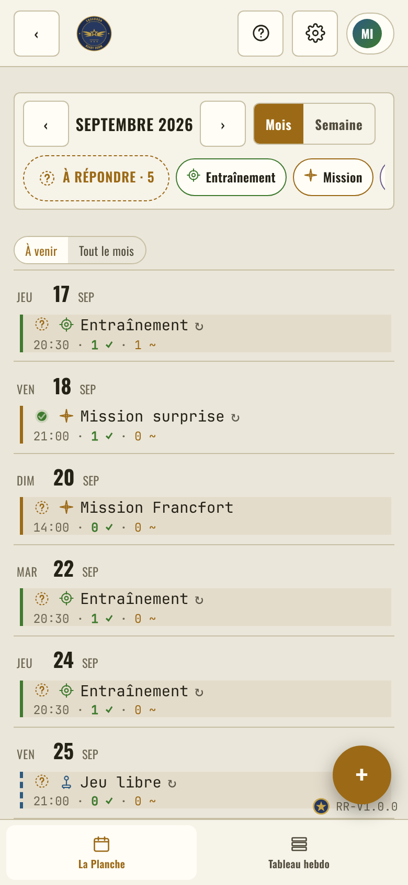

# Squadron Ready Room

**Le portail web d'une escadre virtuelle de DCS World** — la planification des vols et les présences, l'escadre et
ses débriefings, le Centre de Commandement et le Manuel Pilote, derrière une connexion Discord.

*[English version](README.md)*

  

## Ce qu'elle fait

- **Planification** — la planche du mois, de la semaine et l'agenda, les fiches d'évènement et leurs séries, les
  réponses de présence et les rappels Discord qui vont avec.
- **Escadre** — les escadrilles et leurs pilotes, les débriefings de mission tirés des journaux du serveur, la carte
  d'opérations.
- **Centre de Commandement** — les membres, les grades et les droits, les escadrilles et leurs livrées, la
  configuration, les sauvegardes et le journal de chaque changement.
- **Manuel Pilote** — le guide illustré de chaque écran, servi avec l'application.
- **Autres outils** — ouvre [DCS Mission Plan](https://github.com/MirabelleBenou/dcs-mission-plan) et
  [DCS Mission Tools](https://github.com/MirabelleBenou/dcs-mission-tools) depuis l'accueil.

Chaque écran s'utilise sur un ordinateur, une tablette et un téléphone, en français et en anglais, en thème sombre et
clair.

## Un aperçu

*Écrans tirés des données de démonstration des tests (« Example Air Wing »).*

 <b>Accueil</b> — les trois stations et les autres outils

<table>
<tr><td width="50%"></td><td width="50%"></td></tr>
<tr><td align="center"><b>La Planche</b> — le mois des évènements de l'escadre</td><td align="center"><b>Une mission</b> — le roster tiré des journaux du serveur</td></tr>
<tr><td></td><td></td></tr>
<tr><td align="center"><b>L'escadre</b> — son organigramme</td><td align="center"><b>Une escadrille</b> — sa fiche d'unité</td></tr>
<tr><td></td><td></td></tr>
<tr><td align="center"><b>Le dossier d'un pilote</b></td><td align="center"><b>Un vol</b> — son journal, tir par tir</td></tr>
<tr><td></td><td align="center"></td></tr>
<tr><td align="center"><b>Centre de Commandement</b> — les membres</td><td align="center"><b>La Planche</b> sur un téléphone</td></tr>
</table>

## Installation

L'application tourne sous Docker Compose (l'application et PostgreSQL) sur un serveur Linux, et connecte les membres
par une application Discord. Le guide d'installation, en français et en anglais, mène de la préparation du serveur au
premier démarrage, puis aux sauvegardes, aux mises à jour, au dépannage et à la désinstallation. Il est joint en PDF à
chaque release, et en ligne à <https://mirabellebenou.github.io/dcs-squadron-ready-room/fr/>.

## 📄 Licence

[GNU AGPL-3.0-or-later](LICENSE) — libre d'utiliser, de modifier et de partager, usage commercial compris (un service
payant aussi), **à condition de publier le code source de votre version sous la même licence**, services hébergés
compris (article 13). Toute interface doit garder la ligne de crédit « Based on Squadron Ready Room by MirabelleBenou and the 4th VEAW virtual wing » (un terme additionnel de l'article 7(b), voir [`LICENSE`](LICENSE)).

Images, polices et tables de données, avec leur origine et leurs propres conditions : [`ASSETS.md`](ASSETS.md) (en
anglais).

Insigne de la Squadron Ready Room : création originale du projet ; lettrage tiré d'Oswald (SIL Open Font License 1.1), converti en tracés.

## 🙏 Remerciements

- Fait pour la communauté de l'aviation virtuelle de DCS World.
- Polices : Oswald, Zilla Slab et JetBrains Mono (SIL Open Font License 1.1), Special Elite (Apache License 2.0) —
  leurs licences sont dans [`app/static/assets/fonts/`](app/static/assets/fonts/LICENSES.md).
- Vignettes des théâtres dessinées d'après GSHHG (P. Wessel et W. H. F. Smith, LGPL).
- Compagnon de **[DCS Mission Plan](https://github.com/MirabelleBenou/dcs-mission-plan)** et de
  **[DCS Mission Tools](https://github.com/MirabelleBenou/dcs-mission-tools)**.

---

*Ce projet n'est ni affilié à Eagle Dynamics, l'éditeur de DCS World, ni approuvé par lui.*
