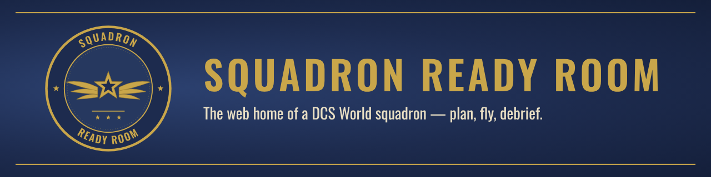

# Squadron Ready Room

**The web portal of a DCS World virtual squadron** — flight scheduling and attendance, the wing and its debriefings,
the Command Center, and the Pilot's Manual, behind a Discord sign-in.

*[Version française](README.fr.md)*

  

## What it does

- **Scheduling** — the month, week and agenda boards, event sheets with their series, attendance answers, and the
  Discord reminders that go with them.
- **Wing** — the squadrons and their pilots, mission debriefings built from the server's logs, the operations map.
- **Command Center** — members, ranks and rights, squadrons and their liveries, configuration, backups and the
  journal of every change.
- **Pilot's Manual** — the illustrated guide to every screen, served with the application.
- **Other tools** — opens [DCS Mission Plan](https://github.com/MirabelleBenou/dcs-mission-plan) and
  [DCS Mission Tools](https://github.com/MirabelleBenou/dcs-mission-tools) from the home screen.

Every screen works on a desktop, a tablet and a phone, in English and in French, with a dark and a light theme.

## A look inside

*Screens from the demonstration data of the tests (“Example Air Wing”).*

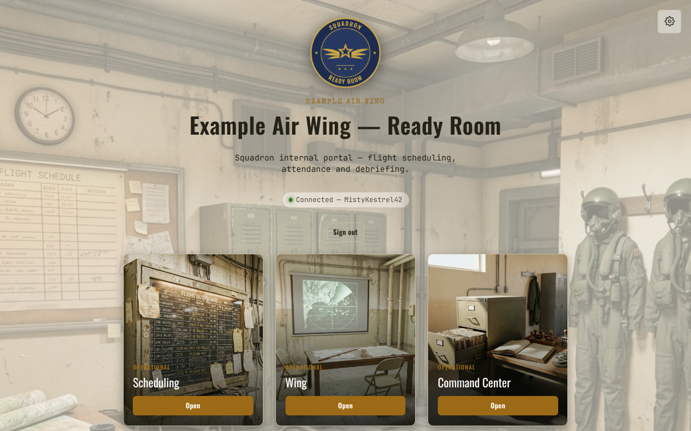 <b>Home</b> — the three stations and the other tools

<table>
<tr><td width="50%">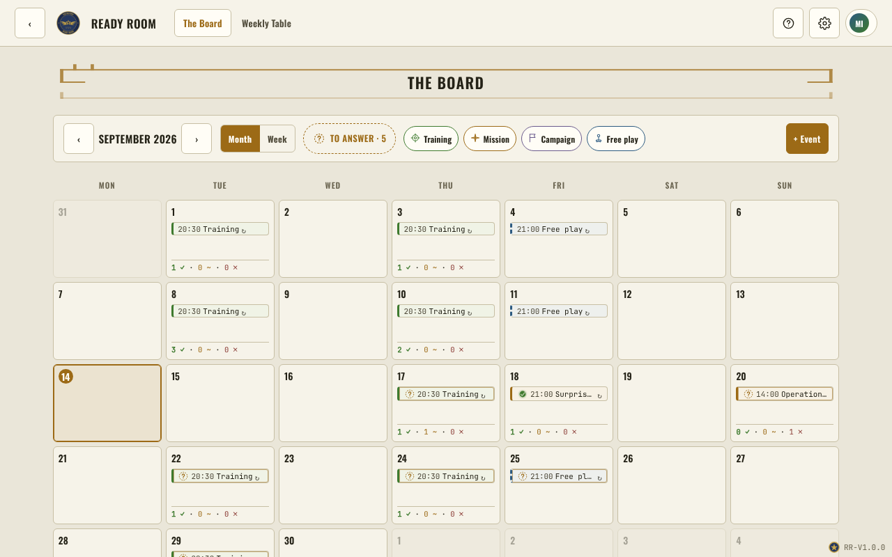</td><td width="50%">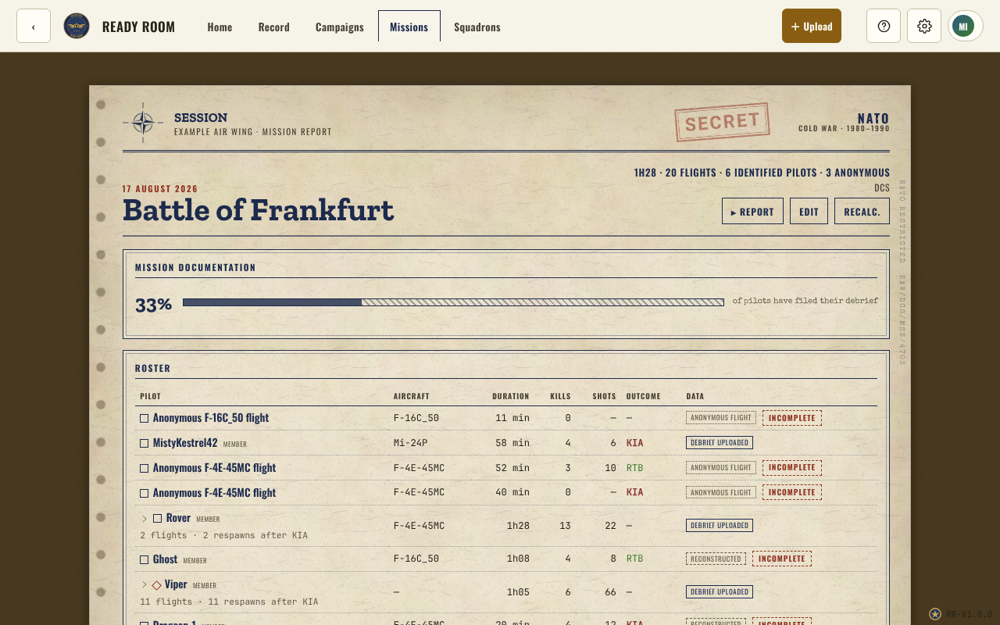</td></tr>
<tr><td align="center"><b>The Board</b> — the month of the wing's events</td><td align="center"><b>A mission</b> — the roster built from the server's logs</td></tr>
<tr><td>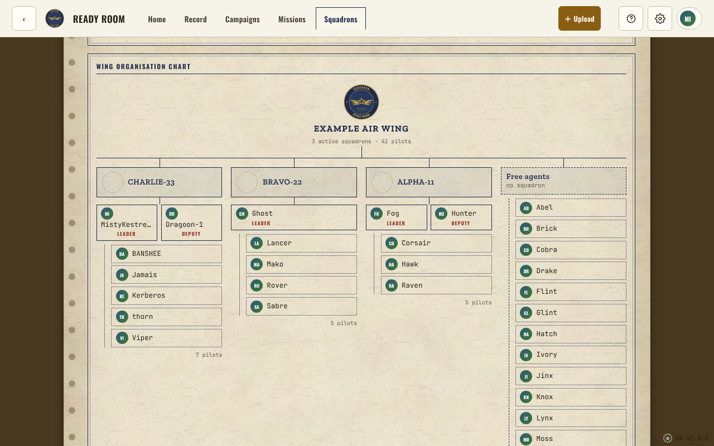</td><td>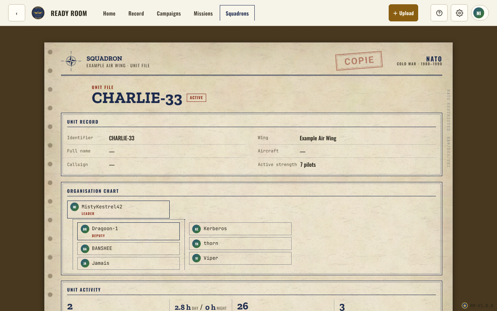</td></tr>
<tr><td align="center"><b>The wing</b> — its organisation chart</td><td align="center"><b>A squadron</b> — its unit file</td></tr>
<tr><td>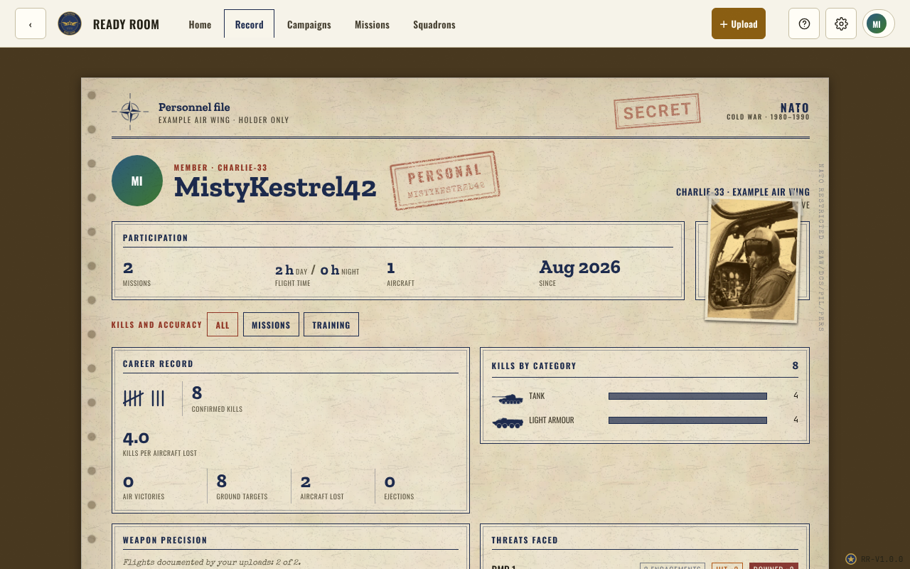</td><td>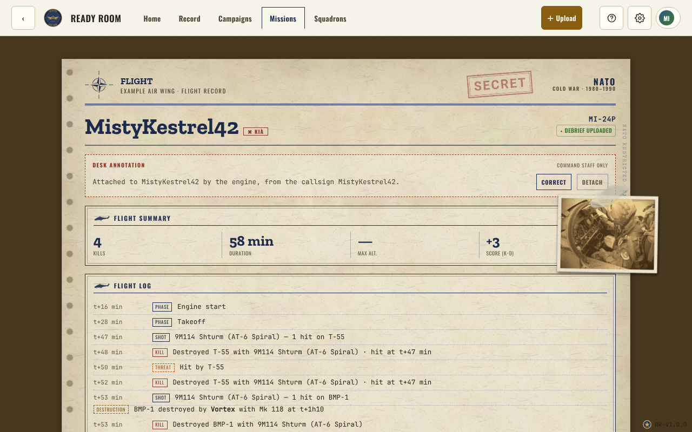</td></tr>
<tr><td align="center"><b>A pilot's personal file</b></td><td align="center"><b>A flight</b> — its log, shot by shot</td></tr>
<tr><td>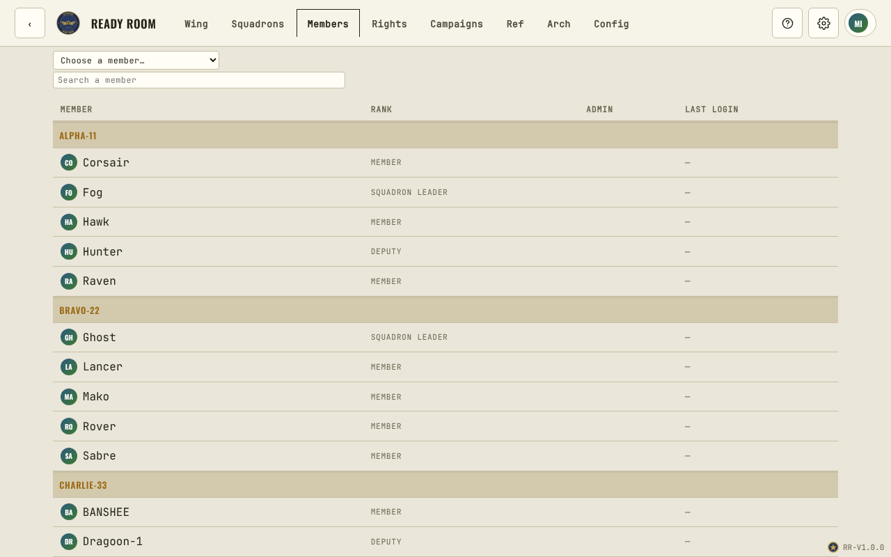</td><td>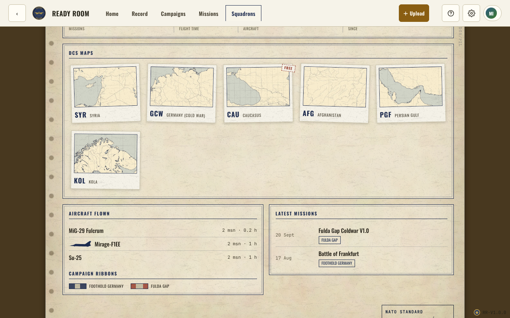</td></tr>
<tr><td align="center"><b>Command Center</b> — the members</td><td align="center"><b>A pilot, as the wing sees him</b> — the DCS maps he owns</td></tr>
<tr><td colspan="2" align="center">
<table>
<tr><td align="center">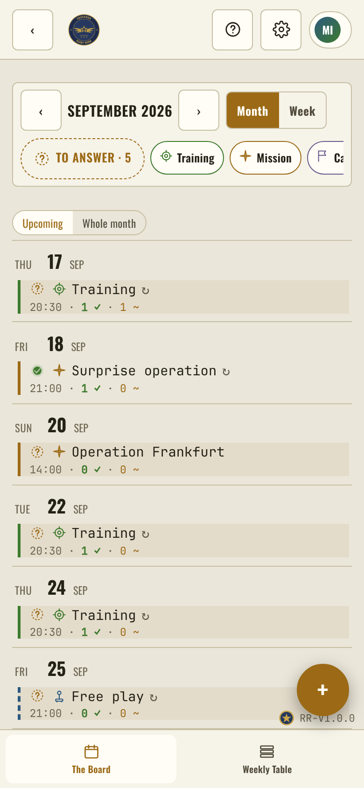</td><td align="center">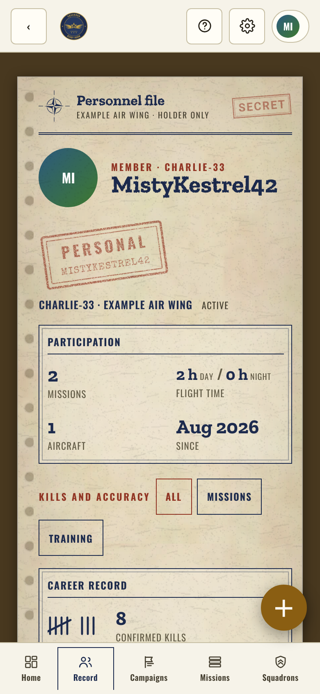</td></tr>
<tr><td align="center"><b>The Board</b> on a phone</td><td align="center"><b>A pilot's personal file</b> on a phone</td></tr>
</table>
</td></tr>
</table>

## Installation

The application runs with Docker Compose (the application and PostgreSQL) on a Linux server, and signs members in
through a Discord application. The installation guide, in English and in French, takes you from preparing the server
to the first start, then through backups, updates, troubleshooting and uninstalling. It is attached as a PDF to every
release, and online at <https://mirabellebenou.github.io/dcs-squadron-ready-room/>.

## 📦 Publishing a release (maintainers)

Releases are created by the workflow `.github/workflows/release.yml`, not by hand. On `main`, `python3 release.py --release RR-V<x.y.z>` first gives the changes under `## Unreleased` in the CHANGELOG their version heading `## RR-V<x.y.z> — YYYY-MM-DD`. Then a branch `release/RR-V<x.y.z>` is pushed: that `main` commit plus files under `.release/` only — `notes.md` (the release text, ending with a `## Version numbers` paragraph copied word for word from the CHANGELOG header — the workflow checks it), optional files to download under `assets/`, and last `manifest.json` (tag, title, `main` commit, and the name, size and SHA-256 of each file). The release itself is the source archive GitHub attaches to the tag.

The workflow checks all of it, creates the release, publishes it as the latest release (which creates the tag on the `main` commit) and deletes the branch. If anything fails, nothing stays published and the branch gets `.release/FAILED.md` with the reason. A branch `release/essai-<name>` runs the same checks without publishing anything and writes `.release/CHECK.md`. Between releases, each update installed on a server is numbered `RR-V<x.y.z>+<n>`. Tests run on every pull request.

## 📄 License

[GNU AGPL-3.0-or-later](LICENSE) — free to use, modify and share, commercial use included (a paid service too),
**provided the source code of your version is published under the same licence**, hosted services included
(section 13). Every interface must keep the credit line “Based on Squadron Ready Room by MirabelleBenou and the 4th VEAW virtual wing” (an additional term under section 7(b), see [`LICENSE`](LICENSE)).

Images, fonts and data tables, with their origin and their own terms: [`ASSETS.md`](ASSETS.md).

Squadron Ready Room insignia: original artwork of the project; lettering from Oswald (SIL Open Font License 1.1), converted to outlines.

## 🙏 Acknowledgments

- Built for the DCS World virtual aviation community.
- Fonts: Oswald, Zilla Slab and JetBrains Mono (SIL Open Font License 1.1), Special Elite (Apache License 2.0) — their
  licences are in [`app/static/assets/fonts/`](app/static/assets/fonts/LICENSES.md).
- Theatre thumbnails drawn from GSHHG (P. Wessel and W. H. F. Smith, LGPL).
- A companion to **[DCS Mission Plan](https://github.com/MirabelleBenou/dcs-mission-plan)** and
  **[DCS Mission Tools](https://github.com/MirabelleBenou/dcs-mission-tools)**.

---

*This project is not affiliated with or endorsed by Eagle Dynamics, the developers of DCS World.*
