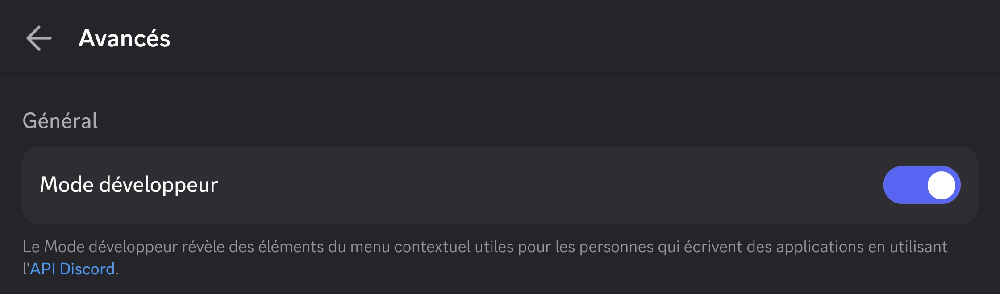
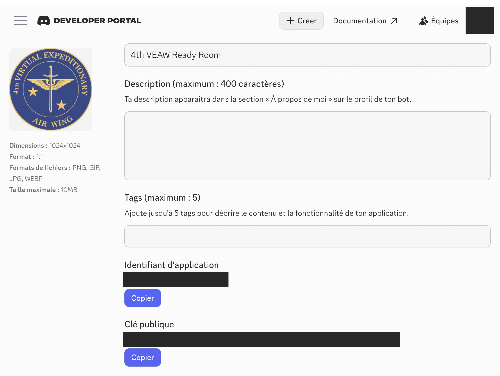
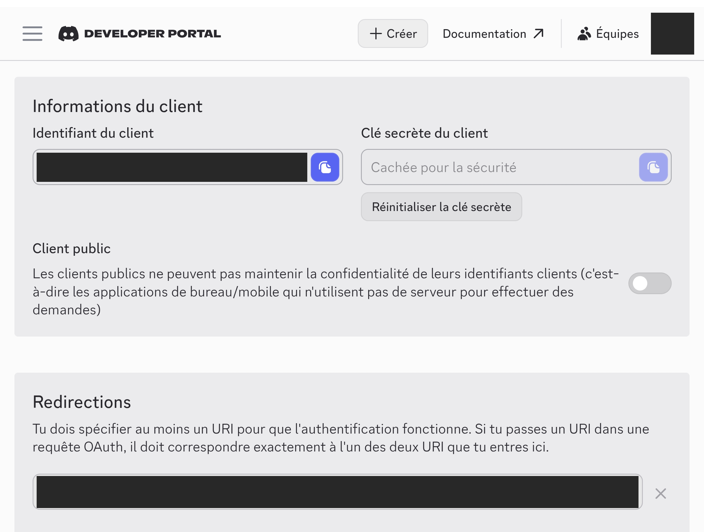
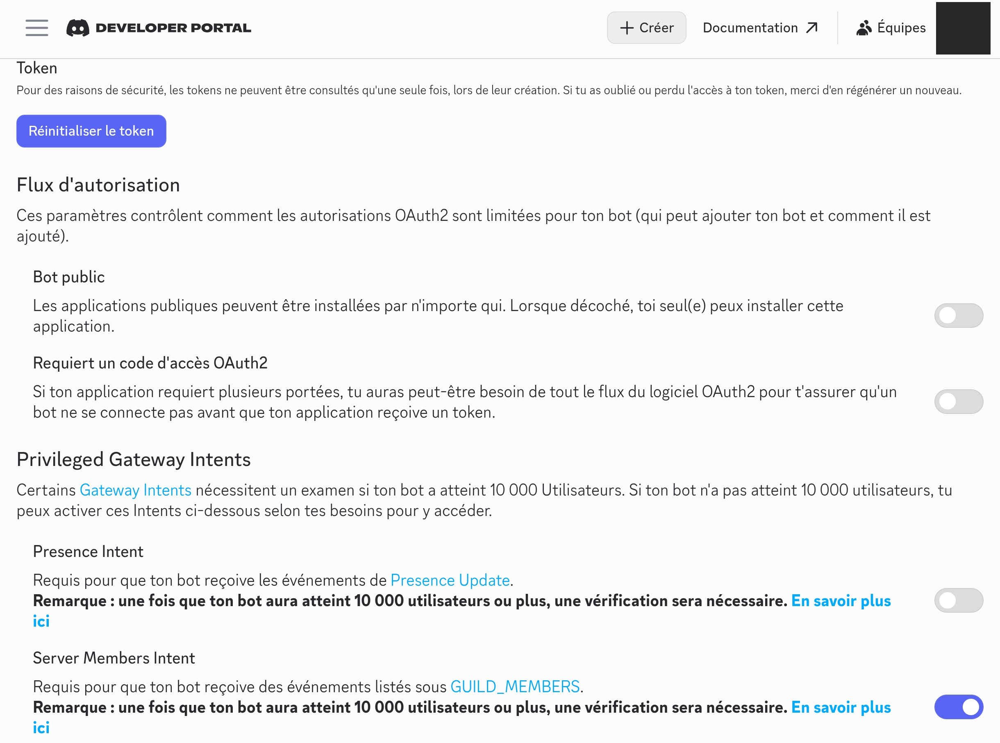
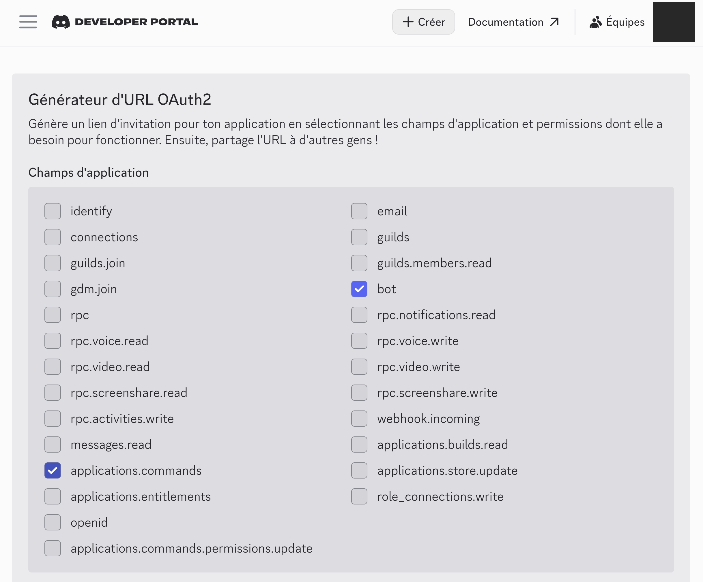
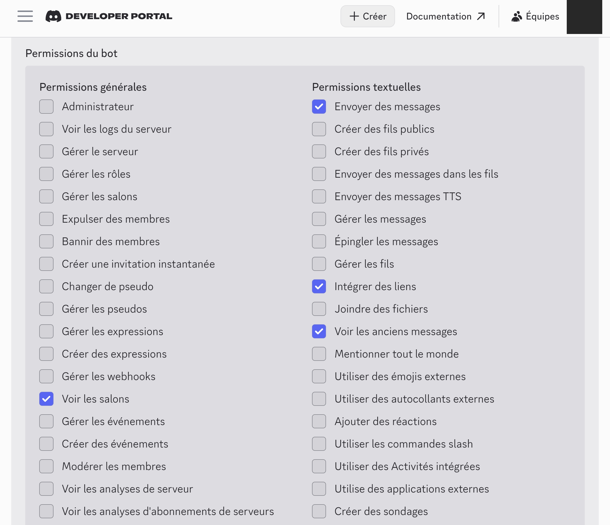
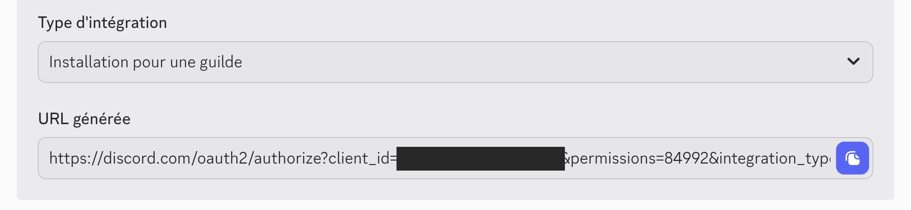

# 3 · Create the Discord application { #discord-application }

The Ready Room keeps no passwords: your members sign in with Discord. For that it needs **a Discord application**,
created in the Developer Portal, and a few IDs from your server. This chapter collects them; [§3.9](#what-goes-where)
says where each one will be used.

!!! note "The portal's language"
    Discord's Developer Portal follows the language of your Discord account. This guide quotes its menus in English;
    the screenshots show it in French.

## 3.1 · Developer Mode and IDs { #developer-mode }

Discord's Developer Mode adds "Copy ID" to its menus. In your Discord client: **User Settings › Advanced › Developer
Mode**, on.



Then collect, by right-clicking:

- the **server ID**: right-click the server icon › **Copy Server ID**;
- **your user ID**: right-click your name › **Copy User ID** — and that of every other founding administrator you want
  ([§5.3](05-configure.md#founders));
- the **ID of the channel** where the bot will post events, if you want the attendance buttons: right-click the channel › **Copy Channel ID**.

A Discord ID is a number of 17 to 20 digits.

## 3.2 · Create the application { #create-application }

1. Open <https://discord.com/developers/applications> and sign in with your Discord account.
2. **New Application**; give it a name your members will recognise (it is shown when they sign in), for example
   "Ready Room" followed by your wing's name; accept the terms; **Create**.
3. **General Information** page: write down the **Application ID** and the **Public Key**.

    

4. **OAuth2** page: under **Client Secret**, **Reset Secret**, confirm, and write down the secret shown.

!!! warning "Warning"
    The *Client Secret* is only shown once. If lost, regenerate it (**Reset Secret**): you then have to change
    `DISCORD_CLIENT_SECRET` in `.env` ([§5.2](05-configure.md#required-variables)).

## 3.3 · The redirect address { #redirect }

Still in **OAuth2**, under **Redirects**, **Add Redirect**:

```text
https://<address>/auth/callback
```

…then **Save Changes** at the bottom of the page.



!!! failure "If it does not work"
    At sign-in, Discord answers *Invalid OAuth2 redirect_uri*: the address entered here is not **exactly** `BASE_URL`
    followed by `/auth/callback` — one `/` too many, `http` instead of `https`, a typo in the name.

## 3.4 · The bot { #bot }

The bot is optional, but it enables the `/readyroom` command, the attendance buttons in Discord and the member roll
call. Create it now, even if you switch it on later.

**Bot** page:

1. **Reset Token**, confirm, and write down the **token** shown (it is only shown once).
2. Under **Privileged Gateway Intents**, switch on **Server Members Intent**, then **Save Changes**.
3. Switch **Public Bot** off, so that only you can invite it.



!!! warning "Warning"
    The bot token gives control of the bot. Paste it nowhere but the Ready Room's **Configuration** screen
    (chapter 7). If it leaks, **Reset Token** and enter the new one.

!!! failure "If it does not work"
    Without **Server Members Intent**, the member roll call lists nobody and says so in its report (« serveur non
    listé », *server not listed*).

## 3.5 · Invite the bot { #invite-bot }

**OAuth2 › URL Generator** page: tick the **`bot`** and **`applications.commands`** scopes, then the **View Channels**,
**Send Messages**, **Embed Links** and **Read Message History** permissions. Open the generated URL at the bottom of the
page, choose your server, **Authorize**.







It is the same link as this one, to open with your *Application ID*:

```text
https://discord.com/oauth2/authorize?client_id=<Application ID>&scope=bot+applications.commands&permissions=84992
```

!!! success "Check"
    The bot appears in your server's member list, offline: that is normal, it does not need to be connected.

## 3.6 · The interactions address { #interactions-url }

Discord must know where to send button clicks and the `/readyroom` command: that is the **Interactions Endpoint URL**
on the **General Information** page. **Do not fill it in now**: Discord checks it immediately, and the Ready Room must
be running and know the *Public Key* to answer. You will set it in [§7.6](07-first-start.md#discord-settings).

## 3.7 · Optional: the digest webhook { #webhook }

The digest posts the schedule to a channel every week. In Discord: channel settings › **Integrations › Webhooks › New
Webhook**; give it a name and an avatar; **Copy Webhook URL**.

!!! warning "Warning"
    A webhook URL is a secret: anyone who knows it can post in the channel.

## 3.8 · Roles to plan { #roles }

The Ready Room decides who gets in, who edits the schedule and who belongs to which squadron **from Discord roles**.
Plan on your server, if you do not have them yet:

- one role (or more) that **opens the Ready Room** — often the wing's member role;
- a role for those who **create schedule events**;
- one role for **squadron leaders** (one for the whole wing);
- **one role per squadron**.

You will link them to the Ready Room on screen, in chapter 8. Until then, only founding administrators get in.

## 3.9 · What you collected, and where it goes { #what-goes-where }

| collected | where | when |
|---|---|---|
| server ID | `.env`: `DISCORD_GUILD_ID` | chapter 5 |
| your user ID (and the other founders') | `.env`: `ADMIN_IDS` | chapter 5 |
| *Application ID* | `.env`: `DISCORD_CLIENT_ID` | chapter 5 |
| *Client Secret* | `.env`: `DISCORD_CLIENT_SECRET` | chapter 5 |
| bot token | **Configuration**: *Bot token* | chapter 7 |
| *Public Key* | **Configuration**: *Application public key* | chapter 7 |
| webhook URL | **Configuration**: *Digest webhook URL* | chapter 7 |
| channel ID | **Configuration**: *Replies channel* | chapter 7 |

Keep these values in a password manager during the installation; once entered, the Ready Room needs them nowhere else.
