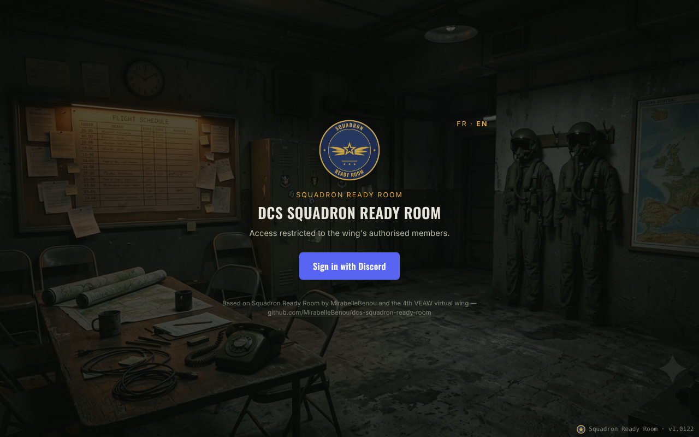
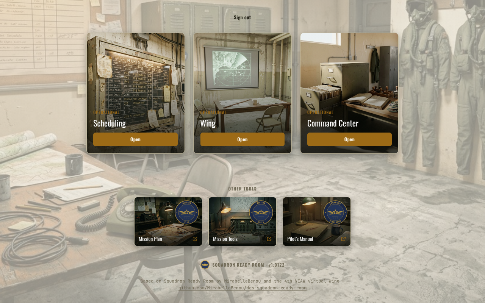
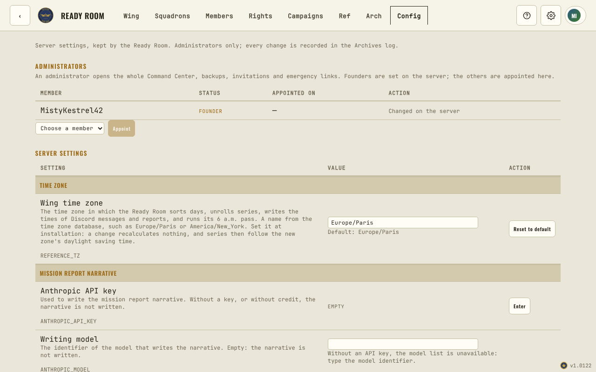
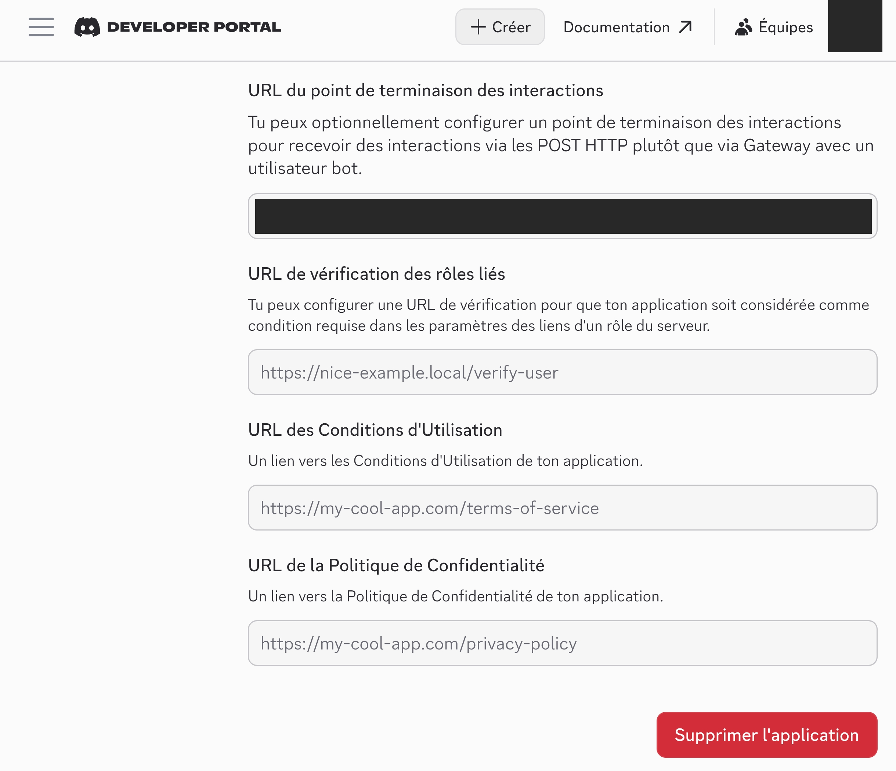
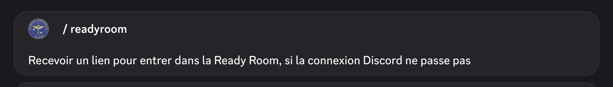
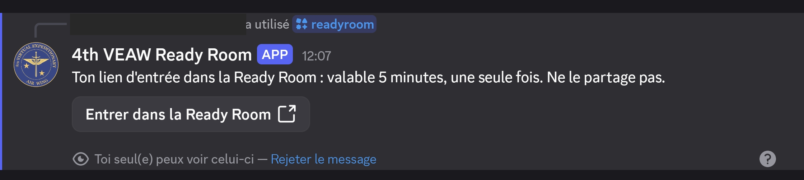

# 7 · First start { #first-start }

## 7.1 · Start { #start }

```sh
cd /opt/readyroom
docker compose up -d --build
```

The first time, Docker downloads the images, builds the application and creates the database: allow **3 to 10
minutes** depending on the server. Later starts take a few seconds.

```sh
docker compose ps
```

!!! success "Check"
    `db` is `healthy`, `app` is `Up` (and `caddy` too, for option A).

## 7.2 · Read the log { #logs }

```sh
docker compose logs -f app
```

(`Ctrl+C` stops reading; the Ready Room keeps running.) At first start you should see, in this order:

```text
[entrypoint] Database ready.
[entrypoint] Migration pending (current: none, target: …): backup before applying.
[entrypoint] Backup OK (…).
[entrypoint] Migrations applied (alembic upgrade head OK).
[entrypoint] Starting the application...
… Application startup complete.
```

Backing up an empty database is normal: the Ready Room takes a backup before every change to its database, the first
one included.

!!! failure "If it does not work"
    `app` keeps restarting; the log says why, on an `[entrypoint] Failure: …` line:

    - **`SESSION_SECRET refused`**: the secret is shorter than 32 characters, or it is still the example value
      ([§5.2](05-configure.md#required-variables));
    - **`configuration refused (CONFIG_KEY missing or invalid)`**: `CONFIG_KEY` missing or malformed
      ([§5.4](05-configure.md#config-key));
    - **`configuration refused (ADMIN_IDS empty: …)`**: no founding administrator ([§5.3](05-configure.md#founders));
    - **`DATABASE_URL, ou POSTGRES_USER, POSTGRES_PASSWORD et POSTGRES_DB, requis`** (*required*, in French in this
      release): one of the three database variables is missing.

    Fix `.env`, then recreate the container — a plain `restart` does not reread `.env`:
    ```sh
    docker compose up -d --force-recreate app
    ```

## 7.3 · Check the HTTPS address { #check-version }

From the server, or from any computer:

```sh
curl -s https://<address>/api/version ; echo
```

!!! success "Check"
    The answer is `{"version":"<release>"}`.

!!! failure "If it does not work"
    Nothing, or a certificate error: go back to chapter 6 for your option (`docker compose logs caddy` for option A,
    `tailscale funnel status` for option B). A `502` error: the proxy answers but `app` is not running
    ([§7.2](#logs)).

## 7.4 · First sign-in { #first-login }

Open `https://<address>` in your browser. The sign-in page follows the browser's language; the small **FR · EN**
selector, at the top of the card, changes it and keeps your choice. **Sign in with Discord**, then authorise the
application.



You land on the home page: the **Scheduling**, **Wing** and **Command Center** stations, and the **Pilot’s Manual**
tile.



!!! note "Other members wait for chapter 8"
    As long as no Discord role opens the Ready Room (**Command Center › Rights**, chapter 8), only founding
    administrators get in. Another member sees **Access denied** — "This account has no role that opens the Ready
    Room.": that is normal at this stage.

!!! failure "If it does not work"
    - *Invalid OAuth2 redirect_uri* at Discord: the redirect address of [§3.3](03-discord-application.md#redirect).
    - **Access denied** — "This account is not a member of the wing's Discord server.": the account is not on the
      `DISCORD_GUILD_ID` server, or the ID is wrong.
    - **Access denied** for you, a founder — "This account has no role…": your ID is not in `ADMIN_IDS`, or `.env`
      changed without recreating the container ([§7.2](#logs)).

## 7.5 · The wing's time zone { #time-zone }

The Ready Room sorts days, unrolls repeating events, writes the times of Discord messages and reports, and runs its
daily 6:00 pass in **the wing's time zone**. Set it **now**, before creating the first event:

1. **Command Center › Configuration**, **Server settings** table, **Time zone** group.
2. **Wing time zone**: choose yours (for example `Europe/Paris` or `America/New_York`), **Save**.



!!! warning "Warning"
    Changing the time zone later recalculates nothing already saved; repeating events then follow the new zone's
    daylight saving time.

## 7.6 · Connect the bot and the interactions { #discord-settings }

*Optional, but needed for `/readyroom` and the attendance buttons.*

1. Still in **Configuration › Server settings**, **Discord — replies** group.
2. **Bot token**: **Enter**, paste the token from [§3.4](03-discord-application.md#bot), **Save**.
3. **Application public key**: **Enter**, paste the *Public Key* from
   [§3.2](03-discord-application.md#create-application), **Save**.
4. In the Discord Developer Portal, **General Information** page, **Interactions Endpoint URL**:

    ```text
    https://<address>/discord/interactions
    ```

    then **Save Changes**. Discord checks the address with the Ready Room right away.

    

5. In your Discord server, type `/readyroom`.

    

!!! success "Check"
    Discord saves the address without error; `/readyroom` answers with a message only you can see, holding an entry
    link to the Ready Room.

    

!!! failure "If it does not work"
    - Discord rejects the address (*The specified interactions endpoint URL could not be verified*): the public key is
      not saved in the Ready Room, or it is not this application's key.
    - `/readyroom` does not appear: the bot was not invited with the `applications.commands` scope
      ([§3.5](03-discord-application.md#invite-bot)); invite it again, then save the public key again.

**The digest**, if you want it: **Discord — digest** group, **Digest webhook URL** (the one from
[§3.7](03-discord-application.md#webhook)), and **Digest language**. The **attendance buttons** are switched on with
**Replies in Discord**, once the **Replies channel** is chosen: the Pilot’s Manual describes them to your members.

## 7.7 · Where you are { #where-you-are }

- [ ] `docker compose ps` shows `db` healthy and `app` up.
- [ ] `https://<address>/api/version` returns the version.
- [ ] You sign in with Discord and see the home page.
- [ ] The wing's time zone is set.
- [ ] *(optional)* `/readyroom` answers in your Discord server.

The Ready Room is running. Chapter 8 sets up the wing, its squadrons and the rights, to open the door to your members.
