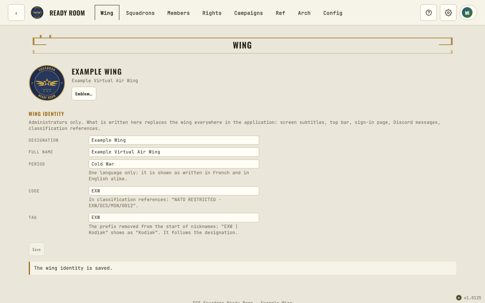
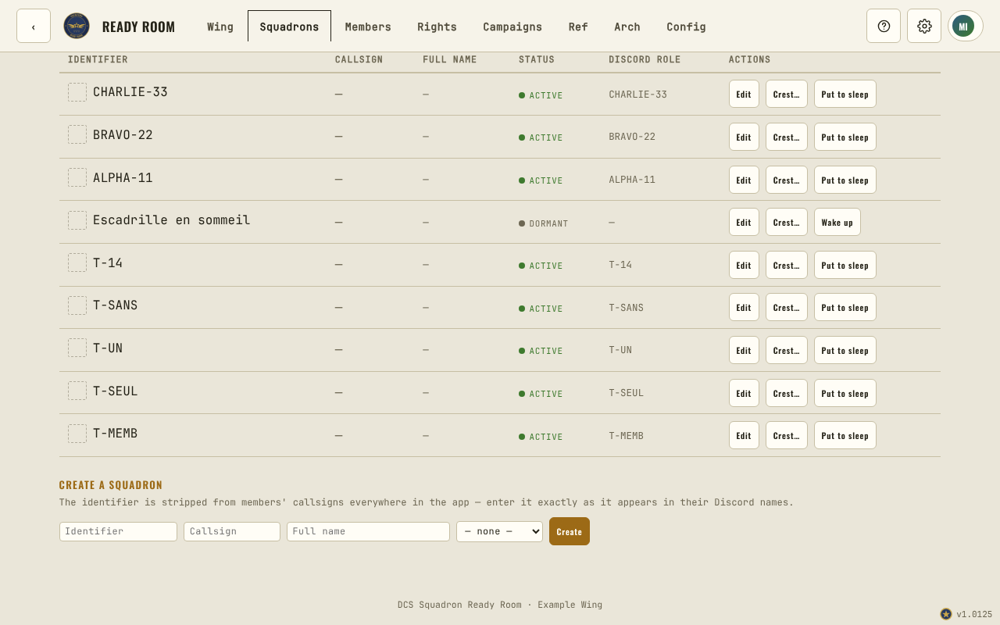
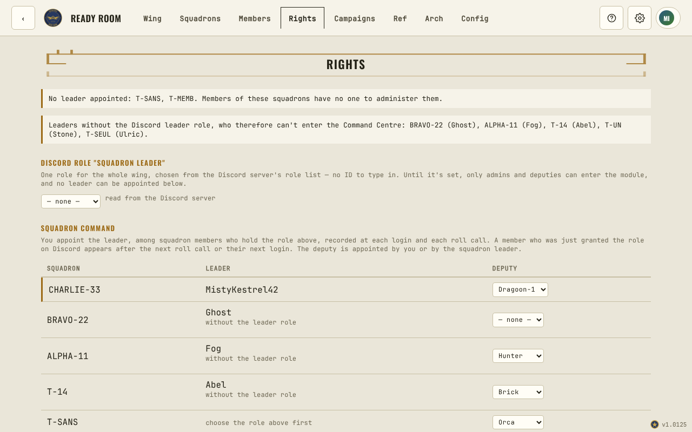
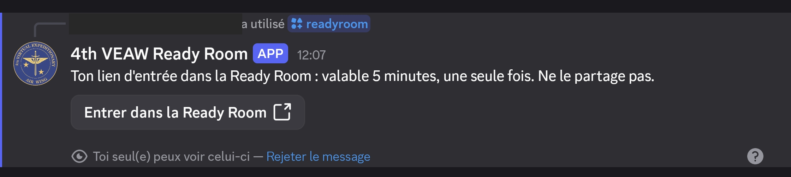

# 8 · First settings { #first-settings }

The Ready Room is running and you are in. This chapter opens the door to your members, in the order it must be done:
access, the wing's identity, its squadrons, the roll call, then rights. Everything happens in the **Command Center**,
the home-page station reserved for administrators and leaders; its screens are chosen from the menu at the top of the
station.

!!! note "Discord roles first"
    The Ready Room creates no roles: it reads those of your Discord server. Before this chapter, create on Discord the
    roles you will need — one per squadron, one for squadron leaders, and the one or ones that open the Ready Room to
    your members.

## 8.1 · Open access { #app-access }

The role list comes from Discord through the bot: the bot must be on your server ([§3.5](03-discord-application.md#invite-bot)) and its token saved ([§7.6](07-first-start.md#discord-settings)). Otherwise the screen says *Discord server unreachable — can't add*.

1. **Command Center › Rights**, block **Application access**.
2. **Add**, then pick the role from your Discord server's role list.
3. Repeat for each role that should open the Ready Room (for example a "member" role, or each squadron role).

A member who holds none of these roles cannot get in; administrators always get in, whatever their roles. Adding or
removing a role takes effect **immediately**.

!!! success "Check"
    The role appears in the block's list. A member who holds it signs in with Discord and reaches the home page.

!!! warning "Warning"
    The list cannot be emptied: the last role cannot be removed, add another one first. Before a removal, the Ready
    Room says how many known members would lose their last access role.

## 8.2 · The wing's identity { #wing }

1. **Command Center › Wing**, block **Wing identity**.
2. Fill in the fields:

    | field | what it holds |
    |---|---|
    | **Designation** | the wing's short name, everywhere in the application |
    | **Full name** | the long name, at the top of the sign-in page |
    | **Period** | the period flown; a single language, shown as typed in both English and French |
    | **Code** | the code in the classification references of reports (`NATO RESTRICTED · <code>/DCS/MSN/0012`) |
    | **Tag** | the prefix removed from the start of nicknames: "`<tag> | Kodiak`" shows as "Kodiak" |

3. **Save**; the Ready Room sums up the changes, **Apply**.
4. **Emblem…**: choose the wing's image (PNG or WebP, 2 MiB at most), **Set the emblem**. It is squared and scaled
   down.

!!! success "Check"
    The top bar and the sign-in page carry the wing's emblem; the screens, its designation.

!!! warning "Warning"
    Changing the **Tag** later rewrites nothing: a Discord nickname that still starts with the old tag keeps it on
    screen, until the member changes it on Discord.

## 8.3 · Squadrons { #squadrons }

A squadron attaches its members through **a Discord role**: whoever holds it belongs to it. A member who has access
without holding a squadron role is a **Free Agent**.

1. **Command Center › Squadrons**, block **Create a squadron**.
2. Fill in:
    - **Identifier** (required): the squadron's prefix, **exactly** as it appears in its members' Discord nicknames;
      the Ready Room removes it from displayed names;
    - **Callsign** and **Full name**;
    - **Discord role**: pick it from the list.
3. **Create**.
4. On the squadron's line, **Crest…**: choose the image (PNG or WebP, 2 MiB at most), **Set the crest**.

!!! success "Check"
    The squadron appears in the list, active, with its role. Its members join it at the next roll call
    ([§8.4](#roll-call)) or at their next sign-in.

!!! failure "If it does not work"
    "This Discord role already attaches …": two active squadrons cannot share a role; create another one on Discord.

**A squadron that no longer flies**: **Put to sleep**, on its line. Its role is no longer recognised; its members
leave it at the next roll call (Free Agents if they keep access, archived otherwise). **Wake up** makes it active again,
with the role you then choose.

## 8.4 · The roll call { #roll-call }

The roster follows Discord: **the roll call** reads your server's members and their roles, puts each one in their
squadron, brings newcomers in and moves out those who have lost access. It runs on its own one minute after each start,
then every 24 hours. Once the squadrons are created, run it by hand:

1. **Command Center › Members**.
2. **Call the roll**.

!!! success "Check"
    The roll-call report appears ("… joins …", "… join as Free Agents") and the members table fills up, each member in
    their squadron.

!!! failure "If it does not work"
    "server not listed (…): nobody could join": the bot is not on the server, or **Server Members Intent** is off
    ([§3.4](03-discord-application.md#bot)). "Roll call stopped — …": nothing was written; the reason follows, run it
    again once it is fixed.

## 8.5 · Rights { #rights }

Still in **Command Center › Rights**, from top to bottom:

1. **Discord role "squadron leader"**: pick the leaders' role, **Apply**. One for the whole wing. Without it, no
   leader can be appointed.
2. **Squadron command**: for each squadron, pick the **Leader** among its members who hold that role, then the
   **Deputy**. A leader then appoints their own deputy.
3. **Planning event editing**: who creates events, **By Discord role** or **By name**. Everyone then edits what they
   created.
4. **Access to the Wing module**: the roles that enter the **Wing** station (reports and debriefing), in addition to
   administrators.
5. **Planning reminders**: the roles and accounts that receive a Discord direct message when a pilot stops answering
   the schedule. With no recipient, no message is sent.
6. **Content rights**: four rights per role — rename a mission and write the wing note, edit someone else's event,
   create and edit a campaign, delete a campaign.

!!! success "Check"
    At the bottom of the screen, the table **Discord roles, and what they do here** says, for each role, what it opens
    and how many known members hold it.

!!! note "When a right takes effect"
    Application access changes at once. The other rights granted take effect when the member reloads the page.

## 8.6 · Guests and the backup link { #guests-and-rescue-link }

**Showing the Ready Room to an outsider** — **Command Center › Rights**, block **Guests — demonstration**:

1. **Discord ID**: paste the person's ID (right-click on their name, "Copy User ID", thanks to the Developer Mode of
   [§3.1](03-discord-application.md#developer-mode)), **Check**.
2. The account found is shown: **Invite for 30 days**.

The guest gets in through **Sign in with Discord**, sees what a leader sees, **strictly read-only**, and appears in no
table. **Extend by 30 days** or **Revoke**, on their line.

**Letting in a member whom the Discord sign-in blocks** — **Command Center › Members**, block **Access check**:

1. Pick the member: the block lists each right they have and what grants it.
2. Under **Backup sign-in link**, **Issue a link**, then **Copy**.
3. Hand the link to the member, and to them alone.

The link opens their session **once, within 24 hours**; issuing a new one cancels the previous one.

!!! warning "Warning"
    Whoever opens the link gets in under the member's name. Never post it in a channel.

!!! note "The member can do without it"
    If `/readyroom` answers in your server ([§7.6](07-first-start.md#discord-settings)), the member gets an entry link
    themselves, visible only to them and valid for five minutes.

    

## 8.7 · Optional settings { #optional-settings }

**The mission report narrative**: an AI writes a prose narrative for each debriefed mission. **Command Center ›
Configuration**, table **Server settings**, group **Mission report narrative**: **Anthropic API key**, **Writing
model**, **Writing effort** ("Medium" is the proven setting). Without a key or without a model, no narrative is
written. What is then sent to Anthropic is described in [§14.4](14-security.md#third-parties).

**The wing key in Mission Plan**: Mission Plan and Mission Tools, if the Ready Room serves them
([§4.3](04-get-the-ready-room.md#suites)), store their settings in each member's browser under a key.
**Configuration**, group **Suites (Mission Plan)**, **Wing key**: left empty, it is derived from the designation; do
not change it afterwards, or your members would lose their saved settings. **Configuration › Server folders**, line
**The suites**, says what the Ready Room finds in their folder.

**The DCS map**: nothing to download. The Ready Room fetches each tile from DCS Olympus (the **Tile server**, group **Map tiles**) and keeps it in `TILES_CACHE_HOST_DIR`. `TILES_HOST_DIR` is optional: tiles you already have there, as `<map key>/<z>/<x>/<y>.png`, are served first.
**Configuration › Server folders** says what each folder contains.

## 8.8 · The Pilot’s Manual { #pilot-manual }

The **Pilot’s Manual** tile, on the home page, opens the members' manual.

## 8.9 · Where you are { #where-you-are }

- [ ] At least one Discord role opens access, and a member who holds it gets in.
- [ ] The wing has its name and its emblem.
- [ ] Each squadron exists, with its role and its crest.
- [ ] The roll call has put members in their squadrons.
- [ ] The leaders' role is chosen, and each squadron has its leader.
- [ ] Who edits the schedule is set.

The door is open. Chapter 9 says what the Ready Room then does on its own.
