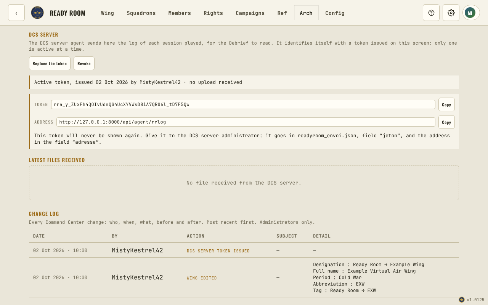

# 10 · Connect a DCS server: the agent { #dcs-agent }

!!! note "Not published yet"
    The DCS server agent is not published yet: it will come with its own first release, `RRA-V1.0.0`. This chapter
    describes its installation as it will be. Until then, debriefings are uploaded by hand from the Wing (**Upload**).

*Optional.* The agent records each mission played on your DCS server and sends it to the Ready Room. Without it, the
Ready Room works, and your pilots can still upload their debriefing files themselves.

This chapter is done on **the Windows PC that runs the DCS server** ([§1.5](01-prerequisites.md#dcs-server)), except
for issuing the token, in the Ready Room.

## 10.1 · What the agent does, and what it does not { #what-the-agent-does }

The agent has two parts, installed separately:

- **the hook**, a single file, `readyroom_agent.lua`, loaded by DCS: during each mission, it writes to a local text
  file the positions, the events (shots, kills…), the connected players and its own load; one `.rrlog` file per
  mission;
- **the sender**, a PowerShell script run by a Windows scheduled task: it posts each finished file to the Ready Room,
  over HTTPS.

**What it does not do**: the hook sends nothing over the network, does not modify `MissionScripting.lua`, disables no
DCS protection and writes only to its own folder, `Logs\ReadyRoom\`. The sender reads only that folder, makes no other
network call, downloads no code and asks for no elevation of rights once installed. No dependencies: neither
DCSServerBot nor Tacview.

!!! warning "In this release"
    The Ready Room **keeps** the files it receives (**Awaiting reading**) but does not yet build debriefings from
    them. Installing the agent now builds up the history of your missions for the release that will read them.

Unzip the agent's archive on the DCS server's PC: it contains `readyroom_agent.lua` and the `envoi\` folder (the
sender).

## 10.2 · Install the hook { #install-hook }

1. Open the server instance's "Saved Games" folder: the one that contains `Logs\dcs.log` and `Config\` (its name
   depends on the installation, for example `C:\Users\<account>\Saved Games\DCS.dcs_serverrelease`).
2. Open `Scripts\Hooks\`; create `Scripts` or `Hooks` if they do not exist.
3. Copy `readyroom_agent.lua` into it.
4. **Restart DCS completely** (close the server, start it again). Hooks are read only when DCS starts: changing
   mission is not enough.
5. Start a mission.

!!! success "Check"
    `Logs\dcs.log` contains a line `[READYROOM] enregistrement dans …\Logs\ReadyRoom\rr_<date>_<mission>.rrlog
    (mode complet)`, and the file grows during the mission.

!!! failure "If it does not work"
    - No `[READYROOM]` line: the file is not in the `Scripts\Hooks\` of **this** instance, or DCS was not restarted.
    - `[READYROOM] … configuration invalide`: a value of `RR_CONFIG` was wrongly changed ([§10.6](#settings)); the
      agent stays idle, DCS is not affected.
    - `[READYROOM] sommeil pour le reste de la mission : …`: the agent met five failures in a row and stood down until
      the end of the mission; the cause follows. It keeps measuring its load, and DCS is not affected.

!!! note "The agent's messages are in French"
    The lines the agent writes, in `dcs.log` and in its own log, are in French; this guide quotes them as they appear.

**A mission's file** is complete when its last line starts with `F`, written at the end of the mission: end missions
cleanly, without killing the process. After a crash, the file stays readable, missing the last ten seconds at most.
Order of magnitude: about 2 MB per hour for a wing evening.

## 10.3 · Issue the token { #agent-token }

In the Ready Room, as an administrator:

1. **Command Center › Archives**, block **DCS server**.
2. **Issue a token**.
3. The Ready Room shows the **Token** and the **Address**, **only once**: copy both.



The **Address** is always `https://<address>/api/agent/rrlog`.

!!! warning "Warning"
    The token will never be shown again. If lost, it can be replaced (**Replace the token**): the old one stops working
    at once. Only one token is active at a time.

## 10.4 · Install the sender { #install-sender }

1. Put the `envoi\` folder in a folder where **the account that runs DCS** can write, for example
   `C:\Users\<account>\ReadyRoomEnvoi\`; never under `Program Files`, nor in `Scripts\Hooks\`.
2. Copy `readyroom_envoi.exemple.json` to `readyroom_envoi.json` and open it in a text editor:
    - `adresse`: the **Address** from [§10.3](#agent-token);
    - `jeton`: the **Token** from [§10.3](#agent-token);
    - `dossier`: the full path of the instance's `Logs\ReadyRoom\`, **with doubled backslashes**, for example
      `C:\\Users\\<account>\\Saved Games\\DCS.dcs_serverrelease\\Logs\\ReadyRoom`.

    Leave `purge_jours`, `stable_min` and `borne_extinction_s` as they are.

3. Open **PowerShell as administrator**, go to the `envoi\` folder, and run, with the Windows account that runs DCS
   (not necessarily the one you are signed in with):

    ```powershell
    powershell.exe -NoProfile -ExecutionPolicy Bypass -File .\installer_envoi.ps1 -Compte <DOMAIN\account>
    ```

    For a local account: `-Compte .\<account>`.

The installer checks `readyroom_envoi.json` — it installs nothing and says why if a field is missing or still holds
the example's `<…>` —, then registers the scheduled task **"ReadyRoom - envoi"**: at Windows start-up, then every five
minutes, with that account, with no session open, no window and no stored password. It touches neither group policy,
nor the firewall, nor DCS.

**What the sender does with a file**: a finished file (last line `F`, or unchanged for 15 minutes and no longer being
written) is sent compressed; a file in which no player connected is not sent. Next to each processed file, a marker:
`.envoye` (received), `.sansjoueur` (set aside), `.refuse` (refused by the Ready Room, never sent again). A failed
upload sets no marker: the file goes again on the next pass. A sent or set-aside file is deleted **30 days** after its
marker; a file that has not gone out never is.

## 10.5 · Check the sender { #check-sender }

After a mission has been played, and a few minutes:

1. On the PC, open `readyroom_envoi.log`, next to the script: one line per event, dated in UTC.
2. In the Ready Room, **Archives › DCS server**: the token says "last upload received …", and the mission appears
   under **Latest files received**, in the state **Awaiting reading**.

To run a pass without waiting for the task:

```powershell
powershell.exe -NoProfile -ExecutionPolicy Bypass -File C:\Users\<account>\ReadyRoomEnvoi\readyroom_envoi.ps1
```

!!! success "Check"
    The log shows `… envoye 201` and the `.rrlog` file has its `.envoye` marker.

!!! failure "If it does not work"
    - `jeton refuse 401`: the token is wrong, or it was replaced or revoked in the Ready Room; issue a new one
      ([§10.3](#agent-token)) and copy it into `readyroom_envoi.json`.
    - `echec …`: the network or the Ready Room did not answer; the next pass retries on its own.
    - Nothing in the log: the task is not running; open Task Scheduler, task **ReadyRoom - envoi**, and read its last
      run result.
    - No mission goes out, but `.sansjoueur` appears: no player had connected; this is intended.

## 10.6 · Adjust, stop, uninstall { #settings }

**The hook's mode** is set at the top of `readyroom_agent.lua`, block `RR_CONFIG`, in a text editor; **restart DCS
completely** after any change:

| line | effect |
|---|---|
| `MODE = "complet"` | positions, events, players and load (the default) |
| `MODE = "evenements"` | events, players and load: no position is read, the lightest mode |
| `MODE = "eteint"` | the agent no longer does anything |

Leave the other lines as they are. An `S` line is written every minute to the mission's file: the server's frames per
second, the time spent in the agent; if you notice a slowdown, switch to `"evenements"` or `"eteint"`.

**Upload at Windows shutdown** (optional, Pro editions and above): `gpedit.msc` › **Computer Configuration › Windows
Settings › Scripts (Startup/Shutdown) › Shutdown**, tab **PowerShell Scripts**, **Add**: the full path of
`readyroom_envoi.ps1`, with the parameter `-Mode extinction`. Without it, the next start-up sends what is left.

**Stop the sender**: in a PowerShell as administrator, from the `envoi\` folder:

```powershell
powershell.exe -NoProfile -ExecutionPolicy Bypass -File .\installer_envoi.ps1 -Desinstaller
```

The task is removed; no file is deleted. Also remove the shutdown script from `gpedit.msc` if it was set, then, if you
wish, the `envoi\` folder.

**Uninstall the hook**: delete `readyroom_agent.lua` from `Scripts\Hooks\`, restart DCS; you can then delete
`Logs\ReadyRoom\`. **In the Ready Room**, **Archives › DCS server › Revoke**: the token stops working.

## 10.7 · Where you are { #where-you-are }

- [ ] `dcs.log` shows the line `[READYROOM] enregistrement dans …` when a mission starts.
- [ ] A token is active in **Archives › DCS server**.
- [ ] The task **ReadyRoom - envoi** is registered, and its log shows `envoye 201` after a mission.
- [ ] The mission appears under **Latest files received**.

Chapter 11 backs up what the Ready Room keeps.
