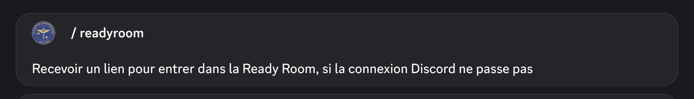

# 13 · Troubleshooting { #troubleshooting }

One entry per symptom: what you see, the cause, the command that shows it, the remedy. Commands are typed on the
server, in the Ready Room's folder (`cd /opt/readyroom`).

For any symptom, the application's log is the first place to look:

```sh
docker compose logs --since 1h app
```

## 13.1 · The application does not start { #app-does-not-start }

**You see**: `docker compose ps` shows `app` as `Restarting`, or the address answers `502`.

**Cause**: a `.env` variable refused, the database unreachable, or a full disk.

**Show it**: `docker compose logs --tail 50 app` — look for the line `[entrypoint] Failure: …`.

**Remedy**: [§7.2](07-first-start.md#logs) gives each message and its fix. Full disk: `df -h`, then free some space
(old backups copied elsewhere, `docker image prune`).

## 13.2 · *Invalid OAuth2 redirect_uri* { #invalid-redirect }

**You see**: Discord shows *Invalid OAuth2 redirect_uri* after **Sign in with Discord**.

**Cause**: the redirect declared in the Discord portal is not exactly `BASE_URL` followed by `/auth/callback`.

**Show it**: `grep ^BASE_URL .env`, and the portal's **OAuth2 › Redirects** page.

**Remedy**: correct one or the other so that they are identical, character for character
([§3.3](03-discord-application.md#redirect)). If you change `.env`: `docker compose up -d --force-recreate app`.

## 13.3 · **Access denied** { #access-denied }

**You see**: the **Access denied** page after the Discord sign-in.

**Cause**, depending on the sentence shown:

- "This account is not a member of the wing's Discord server.": the account is not on the server of
  `DISCORD_GUILD_ID`, or the ID is wrong;
- "This account has no role that opens the Ready Room.": the member holds none of the roles of **Rights ›
  Application access**.

**Show it**: **Members › Access check**, with the member picked: their roles and what grants each right.

**Remedy**: give them the role on Discord, or add their role to access ([§8.1](08-first-settings.md#app-access)). For
a founder: their ID must be in `ADMIN_IDS` ([§7.4](07-first-start.md#first-login)).

## 13.4 · `/readyroom` missing or refused { #readyroom-command }

**You see**: `/readyroom` is not offered in your Discord server, or answers "Your Discord account has no access to the
Ready Room".

**Cause**: the command could not be registered — bot not on the server, invited without the `applications.commands`
scope, or bot token missing; or, for the answer, the member has no access role.

**Show it**:

```sh
docker compose logs app | grep "Commande /readyroom"
```

`Commande /readyroom enregistrée sur le serveur.`: the command is registered. `enregistrement refusé (403) : … Missing
Access`: the bot is not on the server, or lacks `applications.commands`.

**Remedy**: invite the bot again with both scopes ([§3.5](03-discord-application.md#invite-bot)), then, in
**Configuration**, save the **Bot token** again: with the public key saved, the command is registered again at once.
For the "no access" answer: see [§13.3](#access-denied).



## 13.5 · The digest does not arrive { #digest-missing }

**You see**: no digest message in the channel.

**Cause**, one of:

- **Digest webhook URL** empty;
- **Replies in Discord** on: the attendance messages then replace the digest, only one of the two lives in the
  channel;
- no event in the next two weeks: the digest is not posted, and the old one is removed.

**Show it**:

```sh
docker compose logs app | grep "Digest Discord"
```

`DISCORD_WEBHOOK_URL non défini`: the webhook is missing. `digest vide, non posté`: nothing to announce.

**Remedy**: **Configuration**, group **Discord — digest** ([§7.6](07-first-start.md#discord-settings)); a webhook
deleted on the Discord side is created again ([§3.7](03-discord-application.md#webhook)) and entered again.

## 13.6 · The agent writes `jeton refuse 401` { #agent-401 }

**You see**: `jeton refuse 401` in `readyroom_envoi.log`, on the DCS server's PC.

**Cause**: the token in `readyroom_envoi.json` is not the active token; it was replaced or revoked.

**Show it**: **Archives › DCS server**: "Active token, issued …", or "No token".

**Remedy**: **Replace the token** (or **Issue a token**), and copy it into `readyroom_envoi.json`
([§10.3](10-dcs-agent.md#agent-token)). Pending files go out on the next pass.

## 13.7 · The DCS map stays grey, or answers `502` { #map-502 }

**You see**: empty squares on the map; a tile opened on its own answers `502`.

**Cause**: the tile is neither in `TILES_HOST_DIR` nor in the cache, and the **Tile server** did not answer (outage,
outbound network closed).

**Show it**: from the server, `curl -sI https://maps.dcsolympus.com/maps` (or the address set).

**Remedy**: restore the outbound network, or put the tiles you already have into `TILES_HOST_DIR`
([§8.7](08-first-settings.md#optional-settings)). A tile that does not exist at Olympus does not answer `502`: it
simply stays empty.

## 13.8 · Times are off { #wrong-times }

**You see**: events, Discord messages or reports show a time off by one or more hours.

**Cause**: the **Wing time zone** is not yours.

**Show it**: **Configuration › Server settings**, group **Time zone**.

**Remedy**: see [§7.5](07-first-start.md#time-zone). Changing the time zone recalculates nothing already saved.

## 13.9 · A member is not in their squadron { #member-not-in-squadron }

**You see**: the member appears as a Free Agent, or in another squadron.

**Cause**: they do not hold their squadron's role on Discord; or the roll call has not run since they received it.

**Show it**: **Members › Access check** (their roles), and **Squadrons** (each squadron's role).

**Remedy**: give them the role on Discord, then **Members › Call the roll** ([§8.4](08-first-settings.md#roll-call)).
If they do not appear at all: they have never signed in and the roll call does not see them — **Server Members Intent**
must be on ([§3.4](03-discord-application.md#bot)).

## 13.10 · Caddy gets no certificate { #no-certificate }

*Option A only.*

**You see**: the browser reports an invalid certificate, or the connection fails.

**Cause**: the name in `BASE_URL` does not point to this server, or ports 80 and 443 are closed somewhere (server
firewall, hosting provider's firewall, home router).

**Show it**:

```sh
docker compose logs --tail 50 caddy
```

(*challenge failed*, *timeout*: Let's Encrypt could not reach the server.)

**Remedy**: correct the name at your provider ([§2.5](02-prepare-the-server.md#address)) or open the ports
([§2.2](02-prepare-the-server.md#firewall)), then `docker compose restart caddy`.
