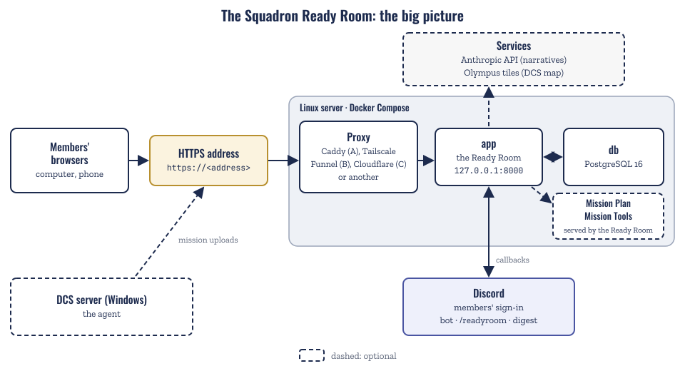

# 0 · Before you start { #before-you-start }

## 0.1 · What the Squadron Ready Room is { #what-it-is }

The Squadron Ready Room is the web application of a DCS World virtual wing. Your members sign in with their Discord
account, from a computer or a phone. It has three stations and a manual:

- **Scheduling** — the wing's calendar: training, operations, campaigns; each member says whether they will attend;
- **Wing** — the debriefings: pilots upload the DCS mission log (`debrief.log`) and, if they have one, their Tacview
  file (`.acmi`); the Ready Room rebuilds the course of the mission and everyone's results;
- **Command Center** — administration: the wing and its squadrons, members and their rights, backups, configuration;
- the **Pilot’s Manual**, which explains the application to your members.

Some features are **optional** and can be switched on later, without reinstalling:

- the weekly **digest** of the schedule in a Discord channel, and the **attendance buttons** in Discord;
- the **`/readyroom`** command, which gives an entry link when the Discord sign-in does not get through;
- the **Mission Plan** and **Mission Tools** suites, served by the Ready Room with the identity of the wing and its
  squadrons ([§4.3](04-get-the-ready-room.md#suites)); without them, the tiles on the home page open their public
  online version, which does not know your wing;
- the **narrative** of mission reports, written by a language model (a paid Anthropic service);
- the DCS server **agent**, which sends the recording of each mission by itself (not published yet, chapter 10).

## 0.2 · The big picture { #overview }

- Your members' **browsers** reach the Ready Room at **an HTTPS address**.
- A **proxy** receives that address and passes it to the application. The guide describes three (chapter 6): Caddy,
  shipped with the Ready Room, if you have a domain name; Tailscale Funnel; a Cloudflare tunnel. Any other proxy that
  serves the application over HTTPS will do.
- The **application** (container `app`) and its **PostgreSQL 16 database** (container `db`) run under Docker Compose,
  on a single Linux machine.
- **Discord** handles members' sign-in and, if you switch them on, the bot, the `/readyroom` command and the digest.
- **Optional** (dashed): Mission Plan and Mission Tools served by the Ready Room, your DCS server's agent, the
  Anthropic API (narratives), the Olympus tile server (the DCS map in Mission Plan).

## 0.3 · Versions { #versions }

This guide matches one release of the Ready Room; its number is in the footer of every page of the PDF. The guide for
another release is attached, as a PDF, to that release's page.

## 0.4 · How to read this guide { #how-to-read }

- A command is in a block; copy it as is. Anything **`<between angle brackets>`** is to be replaced, brackets
  included: `https://<address>` becomes, for example, `https://readyroom.example.org`.
- Ready Room screen names are **in bold**, as they are displayed.
- The markers:

!!! note "Note"
    Useful extra information, which you can skip.

!!! warning "Warning"
    A step that can lose data or open a security hole.

!!! success "Check"
    What you should see at the end of a step.

!!! failure "If it does not work"
    The most likely cause, and what to do.

## 0.5 · How long it takes { #time-needed }

Allow **about two hours** the first time: half an hour to prepare the server, half an hour on the Discord side, the
rest to configure, start and make the first settings. Chapters 0 to 7 take you to the first sign-in; chapters 8 and
after, to the wing's settings and day-to-day running.
