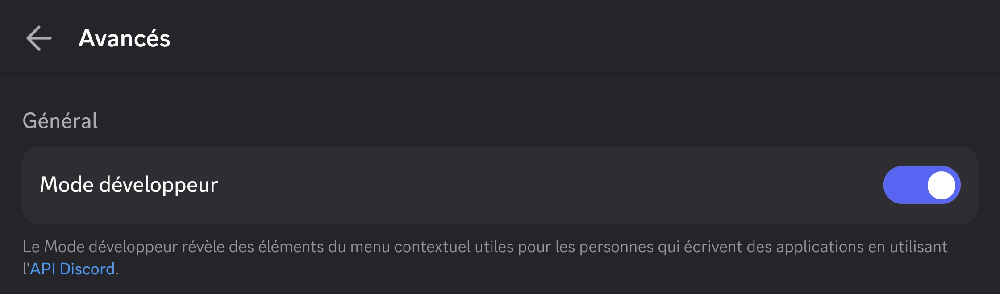
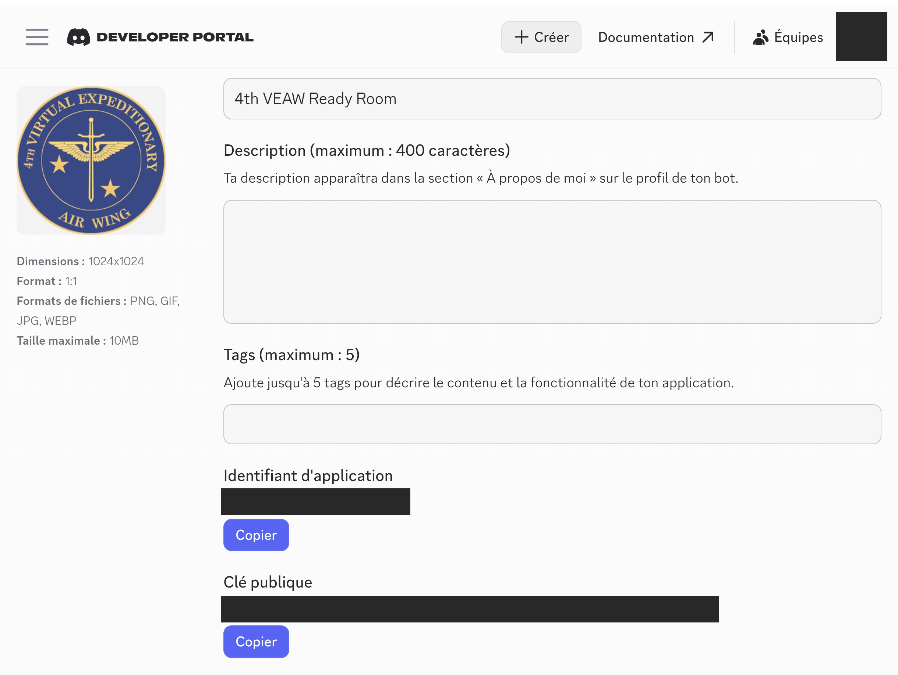
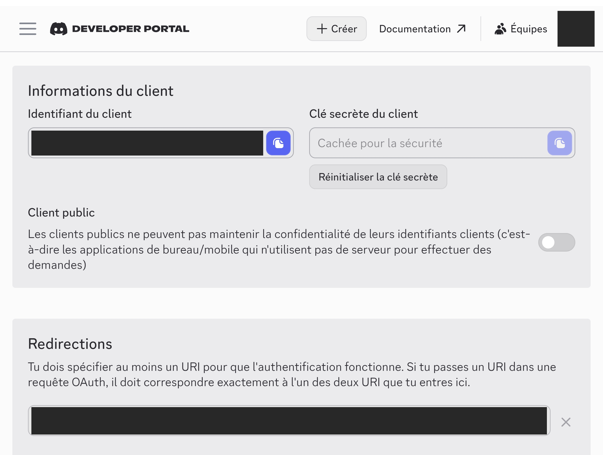
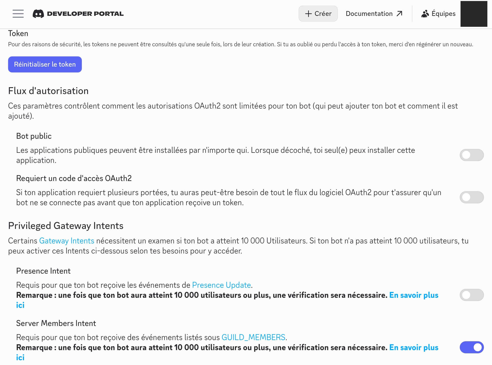
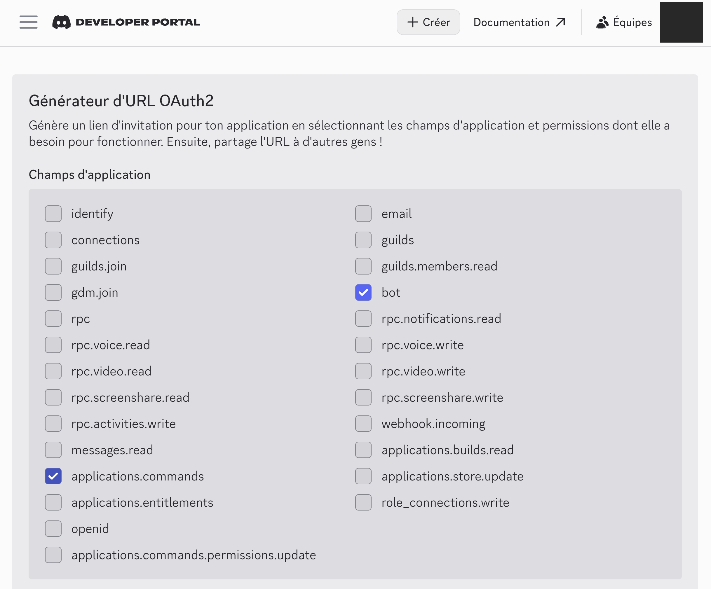
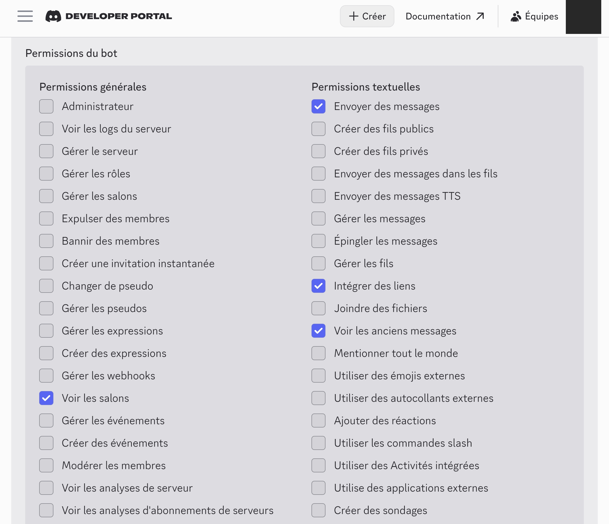
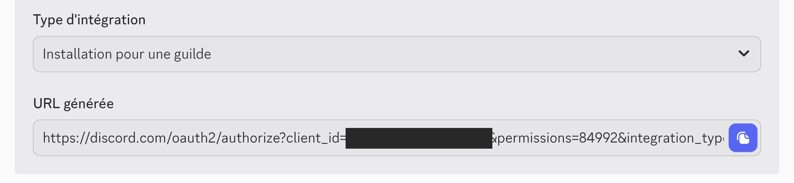

# 3 · Créer l'application Discord { #discord-application }

La Ready Room ne garde aucun mot de passe : vos membres se connectent avec Discord. Il lui faut pour cela **une
application Discord**, créée au portail développeur, et quelques identifiants de votre serveur. Ce chapitre les relève ;
le [§3.9](#what-goes-where) dit où chacun servira.

!!! note "La langue du portail"
    Le portail développeur de Discord suit la langue de votre compte Discord. Ce guide cite ses menus en anglais ; les
    captures le montrent en français.

## 3.1 · Le mode développeur et les identifiants { #developer-mode }

Le mode développeur de Discord ajoute « Copier l'identifiant » aux menus. Dans votre client Discord : **Paramètres
utilisateur › Avancés › Mode développeur**, allumé.



Relevez ensuite, par un clic droit :

- l'**identifiant du serveur** : clic droit sur l'icône du serveur › **Copier l'identifiant du serveur** ;
- **votre identifiant** : clic droit sur votre nom › **Copier l'identifiant de l'utilisateur** — et celui de chaque
  autre administrateur fondateur que vous voulez ([§5.3](05-configure.md#founders)) ;
- l'**identifiant du salon** où le bot postera les évènements, si vous voulez les boutons de présence : clic droit sur le salon › **Copier l'identifiant du salon**.

Un identifiant Discord est un nombre de 17 à 20 chiffres.

## 3.2 · Créer l'application { #create-application }

1. Ouvrez <https://discord.com/developers/applications> et connectez-vous avec votre compte Discord.
2. **New Application** ; donnez-lui un nom que vos membres reconnaîtront (il s'affiche quand ils se connectent), par
   exemple « Ready Room » suivi du nom de votre escadre ; acceptez les conditions ; **Create**.
3. Page **General Information** : relevez l'**Application ID** et la **Public Key**.

    

4. Page **OAuth2** : sous **Client Secret**, **Reset Secret**, confirmez, et relevez le secret affiché.

!!! warning "Attention"
    Le *Client Secret* ne s'affiche qu'une fois. Perdu, il se régénère (**Reset Secret**) : il faut alors changer
    `DISCORD_CLIENT_SECRET` dans `.env` ([§5.2](05-configure.md#required-variables)).

## 3.3 · L'adresse de retour { #redirect }

Toujours dans **OAuth2**, sous **Redirects**, **Add Redirect** :

```text
https://<adresse>/auth/callback
```

…puis **Save Changes** en bas de page.



!!! failure "Si ça ne marche pas"
    À la connexion, Discord répond *Invalid OAuth2 redirect_uri* : l'adresse saisie ici n'est pas **exactement**
    `BASE_URL` suivi de `/auth/callback` — un `/` en trop, `http` à la place de `https`, une faute dans le nom.

## 3.4 · Le bot { #bot }

Le bot est **obligatoire** : la Ready Room lit avec lui les rôles et les membres de votre serveur (chapitre 8). Il ouvre
aussi la commande `/readyroom`, les boutons de présence dans Discord et l'appel des membres. Créez-le maintenant.

Page **Bot** :

1. **Reset Token**, confirmez, et relevez le **jeton** affiché (il ne s'affiche qu'une fois).
2. Sous **Privileged Gateway Intents**, allumez **Server Members Intent**, puis **Save Changes**.
3. Éteignez **Public Bot**, pour que vous seul puissiez l'inviter.



!!! warning "Attention"
    Le jeton du bot donne la main sur le bot. Ne le collez nulle part ailleurs qu'à l'écran **Configuration** de la
    Ready Room (chapitre 7). S'il fuit, **Reset Token**, et saisissez le nouveau.

!!! failure "Si ça ne marche pas"
    Sans **Server Members Intent**, l'appel des membres ne liste personne et le dit dans son compte rendu (« serveur non
    listé »).

## 3.5 · Inviter le bot { #invite-bot }

Page **OAuth2 › URL Generator** : cochez les portées **`bot`** et **`applications.commands`**, puis les permissions
**View Channels**, **Send Messages**, **Embed Links** et **Read Message History**. Ouvrez l'adresse générée en bas de
page, choisissez votre serveur, **Autoriser**.







C'est le même lien que celui-ci, à ouvrir avec votre *Application ID* :

```text
https://discord.com/oauth2/authorize?client_id=<Application ID>&scope=bot+applications.commands&permissions=84992
```

!!! success "Vérifier"
    Le bot apparaît dans la liste des membres de votre serveur, hors ligne : c'est normal, il n'a pas besoin d'être
    connecté.

## 3.6 · L'adresse des interactions { #interactions-url }

Discord doit savoir où envoyer les clics de boutons et la commande `/readyroom` : c'est l'**Interactions Endpoint URL**
de la page **General Information**. **Ne la remplissez pas maintenant** : Discord la vérifie aussitôt, et la Ready Room
doit tourner et connaître la *Public Key* pour lui répondre. Vous la poserez au
[§7.6](07-first-start.md#discord-settings).

## 3.7 · Facultatif : le webhook du digest { #webhook }

Le digest poste chaque semaine le planning dans un salon. Dans Discord : paramètres du salon › **Intégrations ›
Webhooks › Nouveau webhook** ; donnez-lui un nom et un avatar ; **Copier l'URL du webhook**.

!!! warning "Attention"
    L'adresse d'un webhook est un secret : qui la connaît peut poster dans le salon.

## 3.8 · Les rôles à prévoir { #roles }

La Ready Room décide qui entre, qui modifie le planning et qui appartient à quelle escadrille **d'après les rôles
Discord**. Prévoyez sur votre serveur, si vous ne les avez pas :

- un rôle (ou plusieurs) qui **ouvre la Ready Room** — souvent le rôle de membre de l'escadre ;
- un rôle pour ceux qui **créent les évènements** du planning ;
- un rôle pour les **chefs d'escadrille** (un seul pour toute l'escadre) ;
- **un rôle par escadrille**.

Vous les relierez à la Ready Room à l'écran, au chapitre 8. D'ici là, seuls les administrateurs fondateurs entrent.

## 3.9 · Ce que vous avez relevé, et où cela va { #what-goes-where }

| relevé | où | quand |
|---|---|---|
| identifiant du serveur | `.env` : `DISCORD_GUILD_ID` | chapitre 5 |
| votre identifiant (et ceux des autres fondateurs) | `.env` : `ADMIN_IDS` | chapitre 5 |
| *Application ID* | `.env` : `DISCORD_CLIENT_ID` | chapitre 5 |
| *Client Secret* | `.env` : `DISCORD_CLIENT_SECRET` | chapitre 5 |
| jeton du bot | **Configuration** : *Jeton du bot* | chapitre 7 |
| *Public Key* | **Configuration** : *Clé publique de l'application* | chapitre 7 |
| adresse du webhook | **Configuration** : *Adresse du webhook du digest* | chapitre 7 |
| identifiant du salon | **Configuration** : *Salon des réponses* | chapitre 7 |

Gardez ces valeurs dans un gestionnaire de mots de passe le temps de l'installation ; une fois saisies, la Ready Room
n'en a plus besoin ailleurs.
