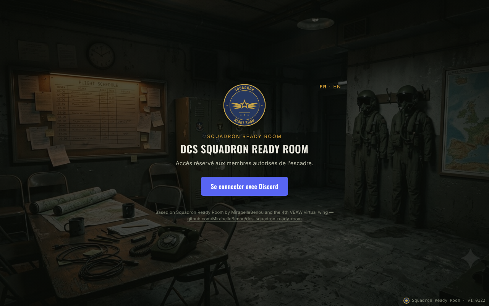
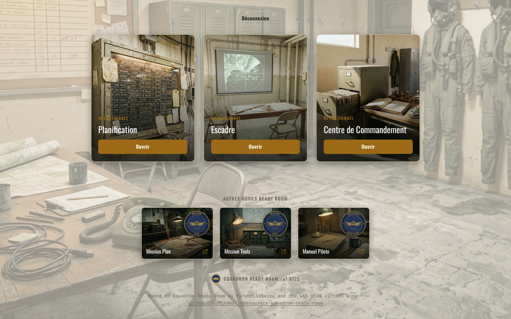
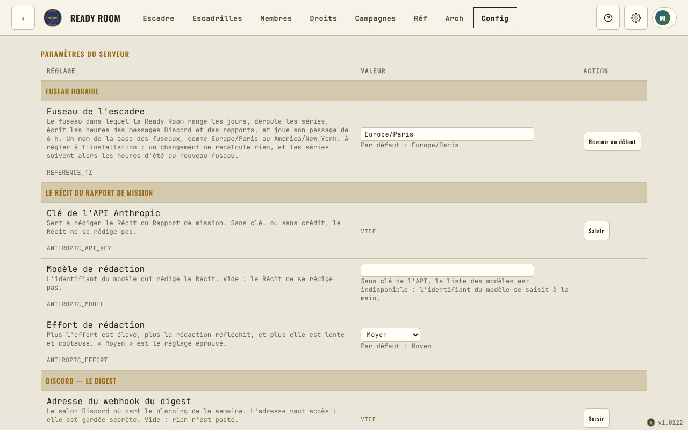
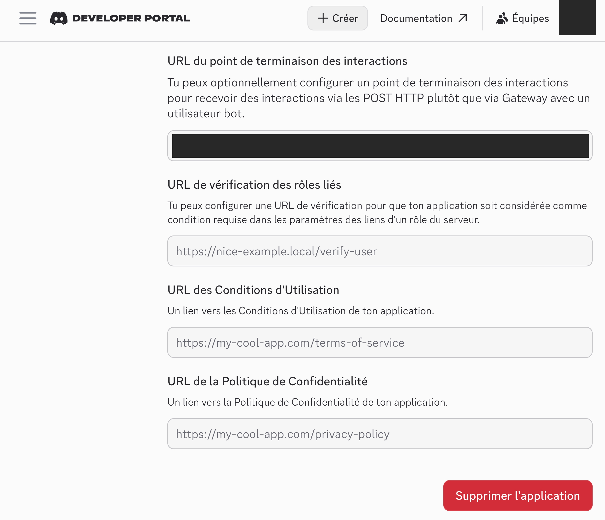
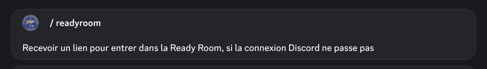
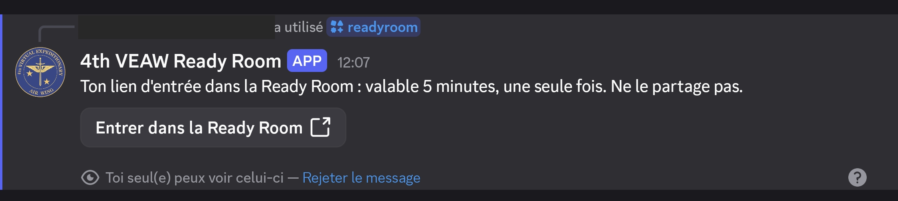

# 7 · Premier démarrage { #first-start }

## 7.1 · Démarrer { #start }

```sh
cd /opt/readyroom
docker compose up -d --build
```

La première fois, Docker télécharge les images, construit l'application et crée la base : comptez **de 3 à 10
minutes** selon le serveur. Les démarrages suivants prennent quelques secondes.

```sh
docker compose ps
```

!!! success "Vérifier"
    `db` est `healthy`, `app` est `Up` (et `caddy` aussi, pour l'option A).

## 7.2 · Lire le journal { #logs }

```sh
docker compose logs -f app
```

(`Ctrl+C` pour quitter la lecture ; la Ready Room continue de tourner.) Les messages de démarrage sont en anglais. Au
premier démarrage, vous devez voir passer, dans cet ordre :

```text
[entrypoint] Database ready.
[entrypoint] Migration pending (current: none, target: …): backup before applying.
[entrypoint] Backup OK (…).
[entrypoint] Migrations applied (alembic upgrade head OK).
[entrypoint] Starting the application...
… Application startup complete.
```

Soit : la base est prête ; une migration attend, sauvegarde d'abord ; sauvegarde faite ; migrations appliquées ;
l'application démarre. La sauvegarde d'une base vide est normale : la Ready Room en prend une avant chaque changement
de sa base, la première fois comprise.

!!! failure "Si ça ne marche pas"
    `app` redémarre en boucle ; le journal dit pourquoi, le plus souvent sur une ligne `[entrypoint] Failure: …` :

    - **`SESSION_SECRET refused`** : le secret fait moins de 32 caractères, ou c'est encore la valeur d'exemple
      ([§5.2](05-configure.md#required-variables)) ;
    - **`configuration refused (CONFIG_KEY missing or invalid)`** : `CONFIG_KEY` absente ou mal formée
      ([§5.4](05-configure.md#config-key)) ;
    - **`configuration refused (ADMIN_IDS empty: …)`** : aucun administrateur fondateur ([§5.3](05-configure.md#founders)) ;
    - **`DATABASE_URL, ou POSTGRES_USER, POSTGRES_PASSWORD et POSTGRES_DB, requis`**, au bout d'une erreur Python plutôt que sur une ligne `Failure` : l'une des trois variables de la base
      manque. Si c'est `POSTGRES_PASSWORD`, `db` lui-même ne démarre pas : lisez `docker compose logs db`.

    Corrigez `.env`, puis recréez le conteneur — un simple `restart` ne relit pas `.env` :
    ```sh
    docker compose up -d --force-recreate app
    ```

## 7.3 · Vérifier l'adresse HTTPS { #check-version }

Depuis le serveur, ou depuis n'importe quel ordinateur :

```sh
curl -s https://<adresse>/api/version ; echo
```

!!! success "Vérifier"
    La réponse est `{"version":"<release>"}`.

!!! failure "Si ça ne marche pas"
    Rien, ou une erreur de certificat : reprenez le chapitre 6 pour votre option (`docker compose logs caddy` pour
    l'option A, `tailscale funnel status` pour l'option B). Une erreur `502` : le proxy répond mais `app` ne tourne
    pas ([§7.2](#logs)).

## 7.4 · La première connexion { #first-login }

Ouvrez `https://<adresse>` dans votre navigateur. La page de connexion suit la langue du navigateur ; le petit
sélecteur **FR · EN**, en haut de la carte, la change et garde votre choix. **Se connecter avec Discord**, puis
autorisez l'application.



Vous arrivez à l'accueil : les stations **Planification**, **Escadre** et **Centre de Commandement**, et la tuile du
**Manuel Pilote**.



!!! note "Les autres membres attendent le chapitre 8"
    Tant qu'aucun rôle Discord n'ouvre la Ready Room (**Centre de Commandement › Droits**, chapitre 8), seuls les
    administrateurs fondateurs entrent. Un autre membre voit **Accès refusé** — « Ce compte n'a aucun rôle qui ouvre la
    Ready Room. » : c'est normal à ce stade.

!!! failure "Si ça ne marche pas"
    - *Invalid OAuth2 redirect_uri* chez Discord : l'adresse de retour du [§3.3](03-discord-application.md#redirect).
    - **Accès refusé** — « Ce compte n'est pas membre du serveur Discord de l'escadre. » : le compte n'est pas sur le
      serveur de `DISCORD_GUILD_ID`, ou l'identifiant est faux.
    - **Accès refusé** pour vous, fondateur — « Ce compte n'a aucun rôle… » : votre identifiant n'est pas dans
      `ADMIN_IDS`, ou `.env` a changé sans recréer le conteneur ([§7.2](#logs)).

## 7.5 · Le fuseau de l'escadre { #time-zone }

La Ready Room range les jours, déroule les évènements qui se répètent, écrit les heures des messages Discord et des
rapports, et fait son passage quotidien de 6 h dans **le fuseau de l'escadre**. Réglez-le **maintenant**, avant de
créer le premier évènement :

1. **Centre de Commandement › Configuration**, tableau **Paramètres du serveur**, groupe **Fuseau horaire**.
2. **Fuseau de l'escadre** : choisissez le vôtre (par exemple `Europe/Paris` ou `America/New_York`), **Enregistrer**.



!!! warning "Attention"
    Changer le fuseau plus tard ne recalcule rien de ce qui est déjà enregistré ; les évènements qui se répètent
    suivent ensuite les heures d'été du nouveau fuseau.

## 7.6 · Brancher le bot et les interactions { #discord-settings }

*Le jeton du bot est **obligatoire** avant le chapitre 8 : la Ready Room lit avec lui les rôles et les membres de votre serveur. La clé publique et l'adresse des interactions (étapes 3 à 5) ne servent qu'à `/readyroom` et aux boutons de présence.*

1. Toujours dans **Configuration › Paramètres du serveur**, groupe **Discord — les réponses**.
2. **Jeton du bot** : **Saisir**, collez le jeton du [§3.4](03-discord-application.md#bot), **Enregistrer**.
3. **Clé publique de l'application** : **Saisir**, collez la *Public Key* du
   [§3.2](03-discord-application.md#create-application), **Enregistrer**.
4. Au portail développeur de Discord, page **General Information**, **Interactions Endpoint URL** :

    ```text
    https://<adresse>/discord/interactions
    ```

    puis **Save Changes**. Discord vérifie aussitôt l'adresse auprès de la Ready Room.

    

5. Dans votre serveur Discord, tapez `/readyroom`.

    

!!! success "Vérifier"
    Discord enregistre l'adresse sans erreur ; `/readyroom` répond par un message que vous seul voyez, avec un lien
    d'entrée dans la Ready Room.

    

!!! failure "Si ça ne marche pas"
    - Discord refuse l'adresse (*The specified interactions endpoint URL could not be verified*) : la clé publique
      n'est pas enregistrée dans la Ready Room, ou n'est pas celle de cette application.
    - `/readyroom` n'apparaît pas : le bot n'a pas été invité avec la portée `applications.commands`
      ([§3.5](03-discord-application.md#invite-bot)) ; réinvitez-le, puis enregistrez de nouveau la clé publique.

**Le digest**, si vous le voulez : groupe **Discord — le digest**, **Adresse du webhook du digest** (celle du
[§3.7](03-discord-application.md#webhook)), et **Langue du digest**. Les **boutons de présence** s'allument par
**Réponses dans Discord**, une fois saisi le **Salon des réponses** (l'identifiant du salon du [§3.1](03-discord-application.md#developer-mode)) : le Manuel Pilote les décrit à vos membres.

## 7.7 · Où vous en êtes { #where-you-are }

- [ ] `docker compose ps` montre `db` en bonne santé et `app` en marche.
- [ ] `https://<adresse>/api/version` rend la version.
- [ ] Vous vous connectez avec Discord et voyez l'accueil.
- [ ] Le fuseau de l'escadre est réglé.
- [ ] *(facultatif)* `/readyroom` répond dans votre serveur Discord.

La Ready Room tourne. Le chapitre 8 règle l'escadre, ses escadrilles et les droits, pour ouvrir la porte à vos membres.
