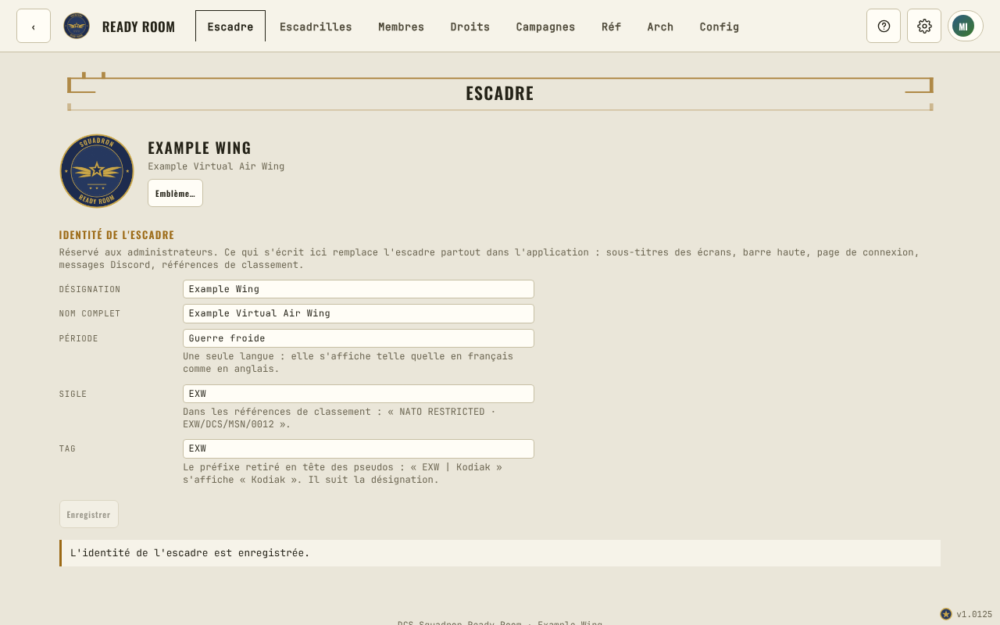
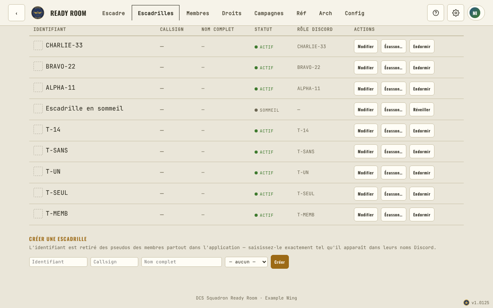
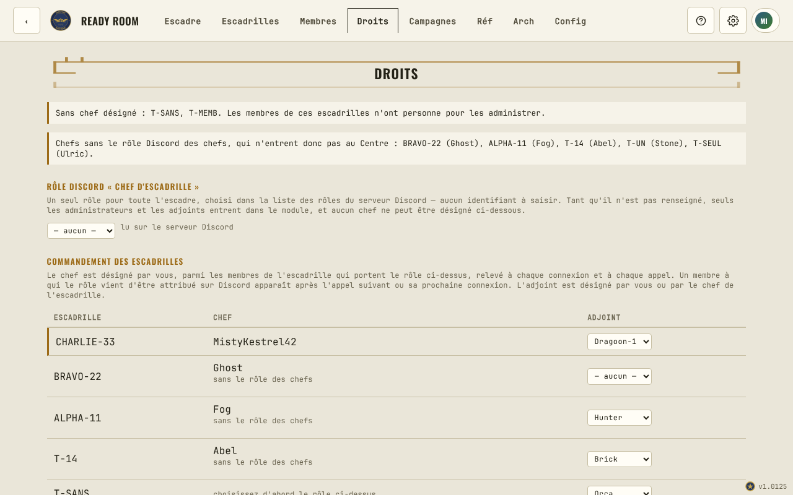
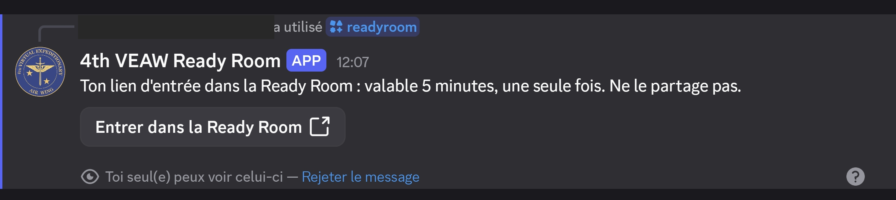

# 8 · Les premiers réglages { #first-settings }

La Ready Room tourne et vous y entrez. Ce chapitre ouvre la porte à vos membres, dans l'ordre où il faut le faire :
l'accès, l'identité de l'escadre, ses escadrilles, l'appel, puis les droits. Tout se passe au **Centre de
Commandement**, la station de l'accueil réservée aux administrateurs et aux chefs ; ses écrans se choisissent dans le
menu en haut de la station.

!!! note "Les rôles Discord d'abord"
    La Ready Room ne crée aucun rôle : elle lit ceux de votre serveur Discord. Créez sur Discord, avant ce chapitre, les
    rôles dont vous aurez besoin — un par escadrille, un pour les chefs d'escadrille, et celui ou ceux qui ouvrent la
    Ready Room à vos membres.

## 8.1 · Ouvrir l'accès { #app-access }

1. **Centre de Commandement › Droits**, bloc **Accès à l'application**.
2. **Ajouter**, puis choisissez le rôle dans la liste des rôles de votre serveur Discord.
3. Recommencez pour chaque rôle qui doit ouvrir la Ready Room (par exemple un rôle « membre », ou chaque rôle
   d'escadrille).

Un membre qui ne porte aucun de ces rôles ne peut pas entrer ; les administrateurs entrent toujours, quels que soient
leurs rôles. Un ajout ou un retrait prend effet **immédiatement**.

!!! success "Vérifier"
    Le rôle paraît dans la liste du bloc. Un membre qui le porte se connecte avec Discord et arrive à l'accueil.

!!! warning "Attention"
    La liste ne se vide pas : le dernier rôle ne peut pas être retiré, ajoutez-en un autre d'abord. Avant un retrait,
    la Ready Room dit combien de membres connus perdraient leur dernier rôle d'accès.

## 8.2 · L'identité de l'escadre { #wing }

1. **Centre de Commandement › Escadre**, bloc **Identité de l'escadre**.
2. Remplissez les champs :

    | champ | ce qu'il porte |
    |---|---|
    | **Désignation** | le nom court de l'escadre, partout dans l'application |
    | **Nom complet** | le nom développé, en tête de la page de connexion |
    | **Période** | la période jouée ; une seule langue, affichée telle quelle en français comme en anglais |
    | **Sigle** | le sigle des références de classement des rapports (`NATO RESTRICTED · <sigle>/DCS/MSN/0012`) |
    | **Tag** | le préfixe retiré en tête des pseudos : « `<tag> | Kodiak` » s'affiche « Kodiak » |

3. **Enregistrer** ; la Ready Room récapitule les changements, **Appliquer**.
4. **Emblème…** : choisissez l'image de l'escadre (PNG ou WebP, 2 Mio au plus), **Poser l'emblème**. Elle est mise au
   carré et réduite.

!!! success "Vérifier"
    La barre haute et la page de connexion portent l'emblème de l'escadre ; les écrans, sa désignation.

!!! warning "Attention"
    Changer le **Tag** plus tard ne réécrit rien : un pseudo Discord qui commence encore par l'ancien tag le garde à
    l'affichage, jusqu'à ce que le membre le change sur Discord.

## 8.3 · Les escadrilles { #squadrons }

Une escadrille rattache ses membres par **un rôle Discord** : celui qui le porte en fait partie. Un membre qui a
l'accès sans porter de rôle d'escadrille est **Free Agent**.

1. **Centre de Commandement › Escadrilles**, bloc **Créer une escadrille**.
2. Remplissez :
    - **Identifiant** (obligatoire) : le préfixe de l'escadrille, **exactement** tel qu'il paraît dans les pseudos
      Discord de ses membres ; la Ready Room le retire des noms affichés ;
    - **Callsign** et **Nom complet** ;
    - **Rôle Discord** : choisissez-le dans la liste.
3. **Créer**.
4. Sur la ligne de l'escadrille, **Écusson…** : choisissez l'image (PNG ou WebP, 2 Mio au plus), **Poser l'écusson**.

!!! success "Vérifier"
    L'escadrille paraît dans la liste, active, avec son rôle. Ses membres la rejoignent à l'appel suivant
    ([§8.4](#roll-call)) ou à leur prochaine connexion.

!!! failure "Si ça ne marche pas"
    « Ce rôle Discord rattache déjà … » : deux escadrilles actives ne peuvent pas partager un rôle ; créez-en un autre
    sur Discord.

**Une escadrille qui ne vole plus** : **Endormir**, sur sa ligne. Son rôle cesse d'être reconnu ; ses membres la
quittent à l'appel suivant (Free Agents s'ils gardent l'accès, archivés sinon). **Réveiller** la rend active, avec le
rôle que vous choisissez alors.

## 8.4 · L'appel des membres { #roll-call }

L'effectif suit Discord : **l'appel** lit les membres de votre serveur et leurs rôles, range chacun dans son escadrille,
fait arriver les nouveaux et sortir ceux qui ont perdu l'accès. Il tourne seul une minute après chaque démarrage, puis
toutes les 24 heures. Après la création des escadrilles, lancez-le à la main :

1. **Centre de Commandement › Membres**.
2. **Faire l'appel**.

!!! success "Vérifier"
    Le compte rendu de l'appel s'affiche (« … arrive au … », « … arrivent en Free Agents ») et le
    tableau des membres se remplit, chacun dans son escadrille.

!!! failure "Si ça ne marche pas"
    « serveur non listé (…) : personne n'a pu entrer » : le bot n'est pas sur le serveur, ou **Server Members Intent**
    est éteint ([§3.4](03-discord-application.md#bot)). « Appel interrompu — … » : rien n'a été écrit ; la raison suit,
    relancez après l'avoir corrigée.

## 8.5 · Les droits { #rights }

Toujours dans **Centre de Commandement › Droits**, de haut en bas :

1. **Rôle Discord « chef d'escadrille »** : choisissez le rôle des chefs, **Appliquer**. Un seul pour toute l'escadre.
   Sans lui, aucun chef ne peut être désigné.
2. **Commandement des escadrilles** : pour chaque escadrille, choisissez le **Chef** parmi ses membres qui portent ce
   rôle, puis l'**Adjoint**. Un chef désigne lui-même son adjoint ensuite.
3. **Édition des événements du planning** : qui crée les évènements, **Par rôle Discord** ou **Nominativement**.
   Chacun modifie ensuite ce qu'il a créé.
4. **Accès au module Escadre** : les rôles qui entrent dans la station **Escadre** (les rapports et le débriefing),
   en plus des administrateurs.
5. **Relances de planning** : les rôles et les comptes qui reçoivent un message privé Discord quand un pilote ne
   répond plus au planning. Sans destinataire, aucun message ne part.
6. **Droits sur le contenu** : quatre droits par rôle — renommer une mission et écrire la note d'escadre, modifier
   l'évènement de quelqu'un d'autre, créer et modifier une campagne, supprimer une campagne.

!!! success "Vérifier"
    En bas de l'écran, le tableau **Les rôles Discord, et ce qu'ils font ici** dit, pour chaque rôle, ce qu'il ouvre
    et combien de membres connus le portent.

!!! note "Quand un droit prend effet"
    L'accès à l'application change à l'instant. Les autres droits accordés prennent effet au rechargement de la page
    du membre.

## 8.6 · Les invités et le lien de secours { #guests-and-rescue-link }

**Montrer la Ready Room à quelqu'un d'extérieur** — **Centre de Commandement › Droits**, bloc **Invités —
démonstration** :

1. **Identifiant Discord** : collez l'identifiant de la personne (clic droit sur son nom, « Copier l'identifiant »,
   grâce au mode développeur du [§3.1](03-discord-application.md#developer-mode)), **Vérifier**.
2. Le compte trouvé s'affiche : **Inviter pour 30 jours**.

L'invité entre par **Se connecter avec Discord**, voit ce qu'un chef voit, **strictement en lecture seule**, et ne
paraît dans aucun tableau. **Prolonger de 30 jours** ou **Révoquer**, sur sa ligne.

**Faire entrer un membre que la connexion Discord bloque** — **Centre de Commandement › Membres**, bloc **Diagnostic
d'accès** :

1. Choisissez le membre : le bloc dit chaque droit qu'il a et ce qui le lui ouvre.
2. Sous **Lien de connexion de secours**, **Émettre un lien**, puis **Copier**.
3. Remettez le lien au membre, à lui seul.

Le lien ouvre sa session **une seule fois, pendant 24 heures** ; en émettre un nouveau annule le précédent.

!!! warning "Attention"
    Quiconque ouvre le lien entre sous le nom du membre. Ne le publiez jamais dans un salon.

!!! note "Le membre peut s'en passer"
    Si `/readyroom` répond dans votre serveur ([§7.6](07-first-start.md#discord-settings)), le membre reçoit lui-même
    un lien d'entrée, visible de lui seul et valable cinq minutes.

    

## 8.7 · Les réglages facultatifs { #optional-settings }

**Le Récit du Rapport de mission** : une IA rédige, pour chaque mission débriefée, un récit en prose. **Centre de
Commandement › Configuration**, tableau **Paramètres du serveur**, groupe **Le Récit du Rapport de mission** : **Clé de
l'API Anthropic**, **Modèle de rédaction**, **Effort de rédaction** (« Moyen » est le réglage éprouvé). Sans clé ou sans
modèle, le Récit ne se rédige pas. Ce qui part alors chez Anthropic est dit au
[§14.4](14-security.md#third-parties).

**La clé de l'escadre dans Mission Plan** : Mission Plan et Mission Tools, s'ils sont servis par la Ready Room
([§4.3](04-get-the-ready-room.md#suites)), rangent leurs réglages dans le navigateur de chaque membre sous une clé.
**Configuration**, groupe **Les suites (Mission Plan)**, **Clé de l'escadre** : vide, elle est tirée de la désignation ;
ne la changez pas ensuite, vos membres perdraient leurs réglages enregistrés. **Configuration › Dossiers du serveur**,
ligne **Les suites**, dit ce que la Ready Room trouve dans leur dossier.

**La carte DCS** : les tuiles extraites des archives de DCS Olympus, dans `TILES_HOST_DIR`, sont servies telles quelles ;
une tuile absente se demande au **Serveur de tuiles** (groupe **Les tuiles de la carte**) et se garde dans
`TILES_CACHE_HOST_DIR`. **Configuration › Dossiers du serveur** dit ce que chaque dossier contient.

## 8.8 · Le Manuel Pilote { #pilot-manual }

La tuile **Manuel Pilote**, à l'accueil, ouvre le manuel des membres.

## 8.9 · Où vous en êtes { #where-you-are }

- [ ] Au moins un rôle Discord ouvre l'accès, et un membre qui le porte entre.
- [ ] L'escadre a son nom et son emblème.
- [ ] Chaque escadrille existe, avec son rôle et son écusson.
- [ ] L'appel a rangé les membres dans leurs escadrilles.
- [ ] Le rôle des chefs est choisi, et chaque escadrille a son chef.
- [ ] Qui édite le planning est réglé.

La porte est ouverte. Le chapitre 9 dit ce que la Ready Room fait ensuite toute seule.
