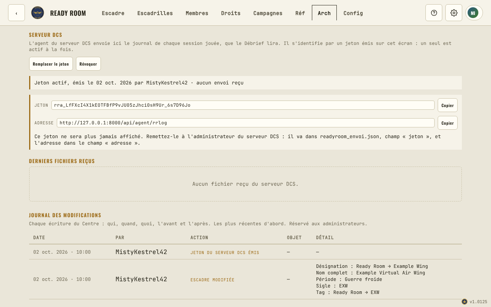

# 10 · Brancher un serveur DCS : l'agent { #dcs-agent }

!!! note "Pas encore publié"
    L'agent du serveur DCS n'est pas encore publié : il viendra avec sa propre première release, `RRA-V1.0.0`. Ce
    chapitre décrit son installation telle qu'elle sera. D'ici là, les débriefings se déposent à la main depuis
    l'Escadre (**Déposer**).

*Facultatif.* L'agent enregistre chaque mission jouée sur votre serveur DCS et l'envoie à la Ready Room. Sans lui, la
Ready Room marche, et vos pilotes peuvent toujours déposer eux-mêmes leurs fichiers de débriefing.

Ce chapitre se fait sur **le PC Windows qui fait tourner le serveur DCS** ([§1.5](01-prerequisites.md#dcs-server)),
sauf l'émission du jeton, dans la Ready Room.

## 10.1 · Ce que fait l'agent, et ce qu'il ne fait pas { #what-the-agent-does }

L'agent a deux parties, qui s'installent séparément :

- **le hook**, un seul fichier, `readyroom_agent.lua`, chargé par DCS : pendant chaque mission, il écrit dans un
  fichier texte local les positions, les évènements (tirs, destructions…), les joueurs connectés et sa propre charge ;
  un fichier `.rrlog` par mission ;
- **l'envoi**, un script PowerShell lancé par une tâche planifiée Windows : il poste à la Ready Room, en HTTPS, chaque
  fichier fini.

**Ce qu'il ne fait pas** : le hook n'envoie rien sur le réseau, ne modifie pas `MissionScripting.lua`, ne désactive
aucune protection de DCS et n'écrit que dans son dossier, `Logs\ReadyRoom\`. L'envoi ne lit que ce dossier, ne fait
aucun autre appel réseau, ne télécharge aucun code et ne demande aucune élévation de droits une fois installé. Aucune
dépendance : ni DCSServerBot, ni Tacview.

!!! warning "Dans cette release"
    La Ready Room **garde** les fichiers reçus (**En attente de lecture**) mais n'en tire pas encore de débriefing.
    Installer l'agent maintenant constitue l'historique de vos missions pour la release qui les lira.

Décompressez l'archive de l'agent sur le PC du serveur DCS : elle contient `readyroom_agent.lua` et le dossier
`envoi\`.

## 10.2 · Installer le hook { #install-hook }

1. Ouvrez le dossier « Saved Games » de l'instance du serveur : celui qui contient `Logs\dcs.log` et `Config\` (son nom
   dépend de l'installation, par exemple `C:\Users\<compte>\Saved Games\DCS.dcs_serverrelease`).
2. Ouvrez `Scripts\Hooks\` ; créez `Scripts` ou `Hooks` s'ils n'existent pas.
3. Copiez-y `readyroom_agent.lua`.
4. **Redémarrez DCS complètement** (fermez le serveur, relancez-le). Les hooks ne sont lus qu'au démarrage de DCS :
   changer de mission ne suffit pas.
5. Lancez une mission.

!!! success "Vérifier"
    `Logs\dcs.log` contient une ligne `[READYROOM] enregistrement dans …\Logs\ReadyRoom\rr_<date>_<mission>.rrlog
    (mode complet)`, et le fichier grossit pendant la mission.

!!! failure "Si ça ne marche pas"
    - Aucune ligne `[READYROOM]` : le fichier n'est pas dans le `Scripts\Hooks\` de **cette** instance, ou DCS n'a pas
      été redémarré.
    - `[READYROOM] … configuration invalide` : une valeur de `RR_CONFIG` a été changée à tort ([§10.6](#settings)) ;
      l'agent reste inactif, DCS n'est pas gêné.
    - `[READYROOM] sommeil pour le reste de la mission : …` : l'agent a rencontré cinq échecs de suite et s'est mis en
      retrait jusqu'à la fin de la mission ; la cause suit. Il continue de mesurer la charge, et DCS n'est pas gêné.

**Le fichier d'une mission** est complet quand sa dernière ligne commence par `F`, écrite à la fin de la mission :
arrêtez les missions proprement, sans tuer le processus. Après un plantage, le fichier reste lisible, amputé des dix
dernières secondes au plus. Ordre de grandeur : environ 2 Mo par heure pour une soirée d'escadre.

## 10.3 · Émettre le jeton { #agent-token }

Dans la Ready Room, en administrateur :

1. **Centre de Commandement › Archives**, bloc **Serveur DCS**.
2. **Émettre un jeton**.
3. La Ready Room affiche le **Jeton** et l'**Adresse**, **une seule fois** : copiez les deux.



L'**Adresse** est toujours `https://<adresse>/api/agent/rrlog`.

!!! warning "Attention"
    Le jeton ne sera plus jamais affiché. Perdu, il se remplace (**Remplacer le jeton**) : l'ancien cesse aussitôt de
    fonctionner. Un seul jeton est actif à la fois.

## 10.4 · Installer l'envoi { #install-sender }

1. Posez le dossier `envoi\` dans un dossier où **le compte qui fait tourner DCS** peut écrire, par exemple
   `C:\Users\<compte>\ReadyRoomEnvoi\` ; jamais sous `Program Files`, ni dans `Scripts\Hooks\`.
2. Copiez `readyroom_envoi.exemple.json` en `readyroom_envoi.json` et ouvrez-le dans un éditeur de texte :
    - `adresse` : l'**Adresse** du [§10.3](#agent-token) ;
    - `jeton` : le **Jeton** du [§10.3](#agent-token) ;
    - `dossier` : le chemin complet de `Logs\ReadyRoom\` de l'instance, **antislashs doublés**, par exemple
      `C:\\Users\\<compte>\\Saved Games\\DCS.dcs_serverrelease\\Logs\\ReadyRoom`.

    Laissez `purge_jours`, `stable_min` et `borne_extinction_s` tels quels.

3. Ouvrez **PowerShell en administrateur**, placez-vous dans le dossier de `envoi\`, et lancez, avec le compte Windows
   qui fait tourner DCS (pas forcément celui avec lequel vous êtes connecté) :

    ```powershell
    powershell.exe -NoProfile -ExecutionPolicy Bypass -File .\installer_envoi.ps1 -Compte <DOMAINE\compte>
    ```

    Pour un compte local : `-Compte .\<compte>`.

L'installateur contrôle `readyroom_envoi.json` — il n'installe rien et dit pourquoi si un champ manque ou garde les
`<…>` de l'exemple —, puis enregistre la tâche planifiée **« ReadyRoom - envoi »** : au démarrage de Windows, puis
toutes les cinq minutes, avec ce compte, sans session ouverte, sans fenêtre et sans mot de passe stocké. Il ne touche
ni à la stratégie de groupe, ni au pare-feu, ni à DCS.

**Ce que l'envoi fait d'un fichier** : un fichier fini (dernière ligne `F`, ou inchangé depuis 15 minutes et que plus
personne n'écrit) part compressé ; un fichier où aucun joueur ne s'est connecté ne part pas. À côté de chaque fichier
traité, un marqueur : `.envoye` (reçu), `.sansjoueur` (écarté), `.refuse` (refusé par la Ready Room, il ne repart
plus). Un envoi qui échoue ne pose pas de marqueur : le fichier repart à la passe suivante. Un fichier envoyé ou écarté
est supprimé **30 jours** après son marqueur ; un fichier qui n'est pas parti ne l'est jamais.

## 10.5 · Vérifier l'envoi { #check-sender }

Après une mission jouée, et quelques minutes :

1. Sur le PC, ouvrez `readyroom_envoi.log`, à côté du script : une ligne par fait, datée en UTC.
2. Dans la Ready Room, **Archives › Serveur DCS** : le jeton dit « dernier envoi reçu le … », et la mission paraît sous
   **Derniers fichiers reçus**, à l'état **En attente de lecture**.

Pour lancer une passe sans attendre la tâche :

```powershell
powershell.exe -NoProfile -ExecutionPolicy Bypass -File C:\Users\<compte>\ReadyRoomEnvoi\readyroom_envoi.ps1
```

!!! success "Vérifier"
    Le journal porte `… envoye 201` et le fichier `.rrlog` a son marqueur `.envoye`.

!!! failure "Si ça ne marche pas"
    - `jeton refuse 401` : le jeton est faux, ou il a été remplacé ou révoqué dans la Ready Room ; émettez-en un
      nouveau ([§10.3](#agent-token)) et reportez-le dans `readyroom_envoi.json`.
    - `echec …` : le réseau ou la Ready Room ne répondait pas ; la passe suivante réessaie seule.
    - Rien dans le journal : la tâche ne tourne pas ; ouvrez le Planificateur de tâches, tâche **ReadyRoom - envoi**,
      et lisez son dernier résultat.
    - Aucune mission ne part, mais `.sansjoueur` apparaît : aucun joueur ne s'était connecté ; c'est voulu.

## 10.6 · Régler, arrêter, désinstaller { #settings }

**Le mode du hook** se règle en tête de `readyroom_agent.lua`, bloc `RR_CONFIG`, dans un éditeur de texte ; **redémarrez
DCS complètement** après tout changement :

| ligne | effet |
|---|---|
| `MODE = "complet"` | positions, évènements, joueurs et charge (par défaut) |
| `MODE = "evenements"` | évènements, joueurs et charge : aucune position n'est lue, le mode le plus léger |
| `MODE = "eteint"` | l'agent ne fait plus rien |

Laissez les autres lignes telles quelles. Une ligne `S` est écrite chaque minute dans le fichier de la mission : images
par seconde du serveur, temps passé dans l'agent ; si vous constatez un ralentissement, passez en `"evenements"` ou
`"eteint"`.

**L'envoi à l'extinction de Windows** (facultatif, éditions Pro et suivantes) : `gpedit.msc` › **Configuration
ordinateur › Paramètres Windows › Scripts (démarrage/arrêt) › Arrêt**, onglet **Scripts PowerShell**, **Ajouter** : le
chemin complet de `readyroom_envoi.ps1`, avec le paramètre `-Mode extinction`. Sans lui, le démarrage suivant envoie ce
qui reste.

**Arrêter l'envoi** : dans un PowerShell en administrateur, depuis le dossier de `envoi\` :

```powershell
powershell.exe -NoProfile -ExecutionPolicy Bypass -File .\installer_envoi.ps1 -Desinstaller
```

La tâche est retirée ; aucun fichier n'est supprimé. Retirez aussi le script d'arrêt de `gpedit.msc` s'il est posé,
puis, si vous le voulez, le dossier `envoi\`.

**Désinstaller le hook** : supprimez `readyroom_agent.lua` de `Scripts\Hooks\`, redémarrez DCS ; vous pouvez ensuite
supprimer `Logs\ReadyRoom\`. **Dans la Ready Room**, **Archives › Serveur DCS › Révoquer** : le jeton cesse de
fonctionner.

## 10.7 · Où vous en êtes { #where-you-are }

- [ ] `dcs.log` porte la ligne `[READYROOM] enregistrement dans …` au lancement d'une mission.
- [ ] Un jeton est actif dans **Archives › Serveur DCS**.
- [ ] La tâche **ReadyRoom - envoi** est enregistrée, et son journal porte `envoye 201` après une mission.
- [ ] La mission paraît sous **Derniers fichiers reçus**.

Le chapitre 11 sauvegarde ce que la Ready Room garde.
