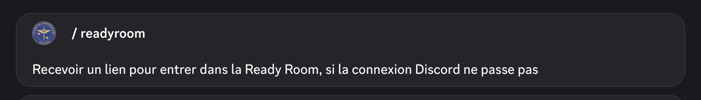

# 13 · Dépannage { #troubleshooting }

Une entrée par symptôme : ce que vous voyez, la cause, la commande qui la montre, le remède. Les commandes se tapent
sur le serveur, dans le dossier de la Ready Room (`cd /opt/readyroom`).

Pour tout symptôme, le journal de l'application est le premier endroit où regarder :

```sh
docker compose logs --since 1h app
```

## 13.1 · L'application ne démarre pas { #app-does-not-start }

**Vous voyez** : `docker compose ps` montre `app` en `Restarting`, ou l'adresse répond `502`.

**Cause** : une variable de `.env` refusée, la base injoignable, ou un disque plein.

**Montrer** : `docker compose logs --tail 50 app` — cherchez la ligne `[entrypoint] Failure: …`.

**Remède** : le [§7.2](07-first-start.md#logs) donne chaque message et sa correction. Disque plein : `df -h`, puis
faites de la place (anciennes sauvegardes copiées ailleurs, `docker image prune`).

## 13.2 · *Invalid OAuth2 redirect_uri* { #invalid-redirect }

**Vous voyez** : Discord affiche *Invalid OAuth2 redirect_uri* après **Se connecter avec Discord**.

**Cause** : l'adresse de retour déclarée au portail Discord n'est pas exactement `BASE_URL` suivie de `/auth/callback`.

**Montrer** : `grep ^BASE_URL .env`, et la page **OAuth2 › Redirects** du portail.

**Remède** : corrigez l'une ou l'autre pour qu'elles soient identiques, au caractère près ([§3.3](03-discord-application.md#redirect)).
Si vous changez `.env` : `docker compose up -d --force-recreate app`.

## 13.3 · **Accès refusé** { #access-denied }

**Vous voyez** : la page **Accès refusé** après la connexion Discord.

**Cause**, selon la phrase affichée :

- « Ce compte n'est pas membre du serveur Discord de l'escadre. » : le compte n'est pas sur le serveur de
  `DISCORD_GUILD_ID`, ou l'identifiant est faux ;
- « Ce compte n'a aucun rôle qui ouvre la Ready Room. » : le membre ne porte aucun rôle de **Droits › Accès à
  l'application**.


**Montrer** : **Membres › Diagnostic d'accès**, le membre choisi : ses rôles et ce qui lui ouvre chaque droit.

**Remède** : donnez-lui le rôle sur Discord, ou ajoutez son rôle à l'accès ([§8.1](08-first-settings.md#app-access)).
Pour un fondateur : son identifiant doit être dans `ADMIN_IDS` ([§7.4](07-first-start.md#first-login)).

## 13.4 · `/readyroom` absent ou refusé { #readyroom-command }

**Vous voyez** : `/readyroom` n'est pas proposé dans votre serveur Discord, ou répond « Ton compte Discord n'a pas
accès à la Ready Room ».

**Cause** : la commande n'a pas pu être déclarée — bot absent du serveur, invité sans la portée
`applications.commands`, ou jeton du bot manquant ; ou, pour la réponse, le membre n'a aucun rôle d'accès.

**Montrer** :

```sh
docker compose logs app | grep "Commande /readyroom"
```

`Commande /readyroom enregistrée sur le serveur.` : la commande est déclarée. `enregistrement refusé (403) : … Missing
Access` : le bot n'est pas sur le serveur, ou sans `applications.commands`.

**Remède** : réinvitez le bot avec les deux portées ([§3.5](03-discord-application.md#invite-bot)), puis, dans
**Configuration**, enregistrez de nouveau le **Jeton du bot** : avec la clé publique enregistrée, la commande est
redéclarée aussitôt. Pour la réponse
« pas accès » : le [§13.3](#access-denied).



## 13.5 · Le digest n'arrive pas { #digest-missing }

**Vous voyez** : aucun message de digest dans le salon.

**Cause**, au choix :

- **Adresse du webhook du digest** vide ;
- **Réponses dans Discord** allumé : les messages de présence remplacent alors le digest, une seule des deux surfaces
  vit dans le salon ;
- aucun évènement dans les deux semaines à venir : le digest ne se poste pas, et l'ancien est retiré.


**Montrer** :

```sh
docker compose logs app | grep "Digest Discord"
```

`DISCORD_WEBHOOK_URL non défini` : le webhook manque. `digest vide, non posté` : rien à annoncer.

**Remède** : **Configuration**, groupe **Discord — le digest** ([§7.6](07-first-start.md#discord-settings)) ; un webhook
supprimé côté Discord se recrée ([§3.7](03-discord-application.md#webhook)) et se saisit de nouveau.

## 13.6 · L'agent écrit `jeton refuse 401` { #agent-401 }

**Vous voyez** : `jeton refuse 401` dans `readyroom_envoi.log`, sur le PC du serveur DCS.

**Cause** : le jeton de `readyroom_envoi.json` n'est pas le jeton actif ; il a été remplacé ou révoqué.

**Montrer** : **Archives › Serveur DCS** : « Jeton actif, émis le … », ou « Aucun jeton ».

**Remède** : **Remplacer le jeton** (ou **Émettre un jeton**), et reportez-le dans `readyroom_envoi.json`
([§10.3](10-dcs-agent.md#agent-token)). Les fichiers en attente partent à la passe suivante.

## 13.7 · La carte DCS reste grise, ou répond `502` { #map-502 }

**Vous voyez** : des cases vides sur la carte ; une tuile ouverte seule répond `502`.

**Cause** : la tuile n'est ni dans `TILES_HOST_DIR` ni dans le cache, et le **Serveur de tuiles** n'a pas répondu (panne,
réseau sortant fermé).

**Montrer** : depuis le serveur, `curl -sI https://maps.dcsolympus.com/maps` (ou l'adresse réglée).

**Remède** : rétablissez le réseau sortant, ou déposez dans `TILES_HOST_DIR` les tuiles que vous avez déjà
([§8.7](08-first-settings.md#optional-settings)). Une tuile qui n'existe pas chez Olympus ne répond pas `502` : elle
reste simplement vide.

## 13.8 · Les heures sont décalées { #wrong-times }

**Vous voyez** : les évènements, les messages Discord ou les rapports donnent une heure décalée d'une ou plusieurs
heures.

**Cause** : le **Fuseau de l'escadre** n'est pas le vôtre.

**Montrer** : **Configuration › Paramètres du serveur**, groupe **Fuseau horaire**.

**Remède** : le [§7.5](07-first-start.md#time-zone). Changer le fuseau ne recalcule rien de ce qui est déjà enregistré.

## 13.9 · Un membre n'est pas dans son escadrille { #member-not-in-squadron }

**Vous voyez** : le membre paraît en Free Agent, ou dans une autre escadrille.

**Cause** : il ne porte pas, sur Discord, le rôle de son escadrille ; ou l'appel n'est pas passé depuis qu'il l'a reçu.

**Montrer** : **Membres › Diagnostic d'accès** (ses rôles), et **Escadrilles** (le rôle de chaque escadrille).

**Remède** : donnez-lui le rôle sur Discord, puis **Membres › Faire l'appel** ([§8.4](08-first-settings.md#roll-call)).
S'il n'apparaît pas du tout : il ne s'est jamais connecté et l'appel ne le voit pas — **Server Members Intent** doit
être allumé ([§3.4](03-discord-application.md#bot)).

## 13.10 · Caddy n'obtient pas de certificat { #no-certificate }

*Option A seulement.*

**Vous voyez** : le navigateur signale un certificat invalide, ou la connexion échoue.

**Cause** : le nom de `BASE_URL` ne pointe pas vers ce serveur, ou les ports 80 et 443 sont fermés quelque part
(pare-feu du serveur, de l'hébergeur, box).

**Montrer** :

```sh
docker compose logs --tail 50 caddy
```


(*challenge failed*, *timeout* : Let's Encrypt n'a pas pu joindre le serveur.)

**Remède** : corrigez le nom chez votre fournisseur ([§2.5](02-prepare-the-server.md#address)) ou ouvrez les ports
([§2.2](02-prepare-the-server.md#firewall)), puis `docker compose restart caddy`.
