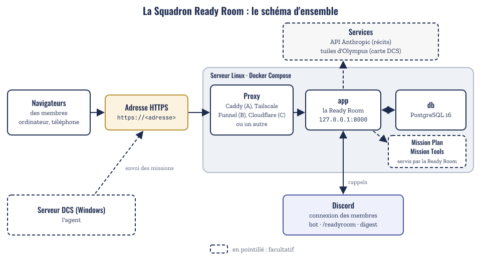

# 0 · Avant de commencer { #before-you-start }

## 0.1 · Ce qu'est la Squadron Ready Room { #what-it-is }

La Squadron Ready Room est l'application web d'une escadre virtuelle de DCS World. Vos membres s'y connectent avec
leur compte Discord, depuis un ordinateur ou un téléphone. Elle a trois stations et un manuel :

- **Planification** — le calendrier de l'escadre : entraînements, opérations, campagnes ; chaque membre dit s'il
  vient ;
- **Escadre** — les débriefings : les pilotes déposent le journal de mission de DCS (`debrief.log`) et, s'ils en ont,
  leur fichier Tacview (`.acmi`) ; la Ready Room en tire le déroulé de la mission et les résultats de chacun ;
- **Centre de Commandement** — l'administration : l'escadre et ses escadrilles, les membres et leurs droits, les
  sauvegardes, la configuration ;
- le **Manuel Pilote**, qui explique l'application à vos membres.

Certaines fonctions sont **facultatives** et s'allument plus tard, sans réinstaller :

- le **digest** hebdomadaire du planning dans un salon Discord, et les **boutons de présence** dans Discord ;
- la commande **`/readyroom`**, qui donne un lien d'entrée quand la connexion Discord ne passe pas ;
- les suites **Mission Plan** et **Mission Tools**, servies par la Ready Room avec l'identité de l'escadre et ses
  escadrilles ([§4.3](04-get-the-ready-room.md#suites)) ; sans elles, les tuiles de l'accueil ouvrent leur version
  publique en ligne, qui ne connaît pas votre escadre ;
- le **récit** des rapports de mission, rédigé par un modèle de langage (service payant d'Anthropic) ;
- l'**agent** du serveur DCS, qui envoie lui-même l'enregistrement de chaque mission (chapitre 10).

## 0.2 · Le schéma d'ensemble { #overview }

- Les **navigateurs** de vos membres joignent la Ready Room à **une adresse HTTPS**.
- Un **proxy** reçoit cette adresse et la passe à l'application. Le guide en décrit trois (chapitre 6) : Caddy, fourni
  avec la Ready Room, si vous avez un nom de domaine ; Tailscale Funnel ; un tunnel Cloudflare. Tout autre proxy qui
  sert l'application en HTTPS convient.
- L'**application** (conteneur `app`) et sa **base PostgreSQL 16** (conteneur `db`) tournent sous Docker Compose, sur
  une seule machine Linux.
- **Discord** sert à la connexion des membres, et, si vous les allumez, au bot, à la commande `/readyroom` et au
  digest.
- **Facultatifs** (en pointillé) : Mission Plan et Mission Tools servis par la Ready Room, l'agent de votre serveur DCS,
  l'API d'Anthropic (récits), le serveur de tuiles d'Olympus (la carte DCS de Mission Plan).

## 0.3 · Les versions { #versions }

Ce guide correspond à une release de la Ready Room ; son numéro est en pied de chaque page du PDF. Le guide d'une autre
release est joint à la page de cette release, en PDF.

## 0.4 · Comment lire ce guide { #how-to-read }

- Une commande est dans un bloc ; copiez-la telle quelle. Ce qui est **`<entre chevrons>`** est à remplacer, chevrons
  compris : `https://<adresse>` devient par exemple `https://readyroom.example.org`.
- Les noms d'écrans de la Ready Room sont **en gras**, tels qu'ils s'affichent.
- Les repères :

!!! note "Note"
    Un complément utile, qu'on peut sauter.

!!! warning "Attention"
    Un geste qui peut faire perdre des données ou ouvrir une faille.

!!! success "Vérifier"
    Ce que vous devez voir à la fin d'une étape.

!!! failure "Si ça ne marche pas"
    La cause la plus probable et ce qu'il faut faire.

## 0.5 · Le temps qu'il faut { #time-needed }

Comptez **environ deux heures** la première fois : une demi-heure pour préparer le serveur, une demi-heure côté
Discord, le reste pour configurer, démarrer et faire les premiers réglages. Les chapitres 0 à 7 vous mènent jusqu'à
la première connexion ; les chapitres 8 et suivants, aux réglages de l'escadre et à l'exploitation.
